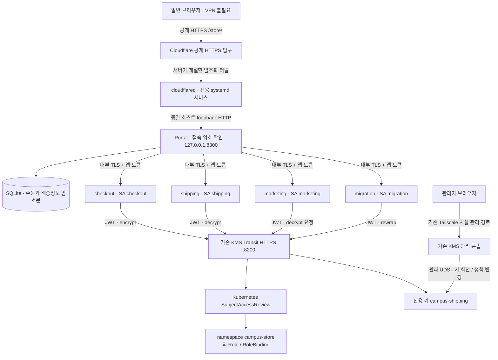
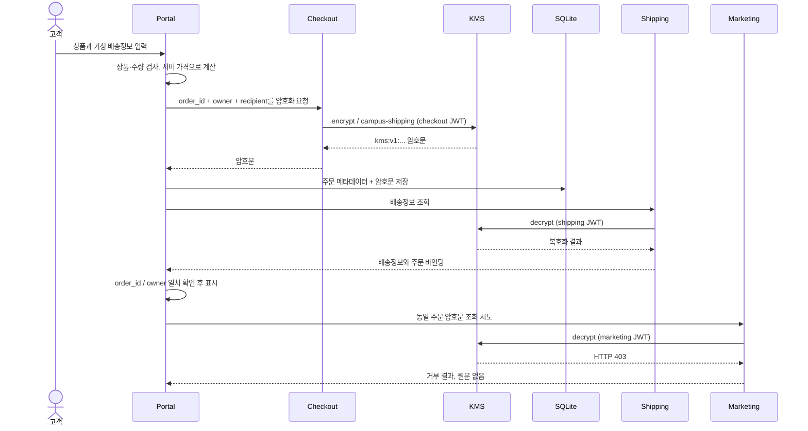

# Campus Store — KMS 연동 시나리오와 구성도

작성일: 2026-10-14. 접근 경로 개정: 2026-10-15 (한국 시간). 이 문서는 현재 저장소의 Transit API, ServiceAccount JWT 인증, Kubernetes SAR 인가, 키 회전·rewrap·최소 복호화 버전 기능을 사용하는 **발표용 애플리케이션**의 구현 명세다.

구현 위치는 [`apps/campus-store`](../../apps/campus-store), 배포 도구는 [`deploy/campus-store`](../../deploy/campus-store)다. **운영 클러스터 적용 여부와 실제 시험 결과는 [검증 기록](verification.md)을 기준으로 판단한다.** 최초 스크린샷은 격리 환경 기록이며, 공개 HTTPS 전환 후의 화면과 증거는 검증 기록에서 구분한다. 현재 데모 접속에는 Tailscale 설치나 가입이 필요 없다.

## 1. 시나리오: 캠퍼스 굿즈 쇼핑몰

고객이 머그컵과 가방을 주문한다. 배송팀은 배송지를 확인하고 주문을 발송한다. 판매 분석팀은 어떤 상품이 잘 팔리는지 살펴보지만 배송주소를 읽을 수 없다. 운영자는 업무가 계속되는 동안 보호 키를 교체하고 기존 주문을 새 버전으로 옮긴다.

청중이 이미 알고 있는 **상품 선택 → 주문 → 배송 → 판매 현황**을 먼저 보여 주고, 그 뒤에서 KMS가 어떤 요청을 허용하거나 거부하는지 설명한다. 주문 한 건의 기술 정보만 나열하지 않고 상품 카탈로그, 장바구니, 주문 내역, 배송 상태, 매출 집계를 연결했다.

| 화면 | 사용자가 하는 일 | 보여 주는 KMS 기능 |
|---|---|---|
| 스토어 | 6종의 상품 탐색, 분류, 장바구니, 모의 주문 | 주문 접수 시 실제 Transit encrypt |
| 내 주문 | 본인 주문과 배송 단계 확인 | DB의 배송정보는 암호문으로 유지 |
| 배송 관리 | 주문별 배송정보 확인, 다음 배송 단계로 변경 | shipping ServiceAccount의 decrypt 허용 |
| 판매 현황 | 주문 수·모의 매출·상품 판매량 확인 | 개인정보 복호화 없이 업무 수행 |
| 분석팀의 조회 시도 | 같은 주문의 배송정보 접근 시도 | marketing ServiceAccount의 실제 KMS 403 |
| 보호 과정 | 저장 암호문, 버전, 요청 결과, 재암호화 확인 | 변조 검출, rewrap, 최소 복호화 버전 정책 |

서비스의 이름·상품·주문·고객은 가상이다. 결제 및 택배 연동은 없다. 고객 이름을 고르는 기능은 발표자가 화면을 전환하는 **체험 계정 선택**이며 실제 사용자 인증을 구현한 것이 아니다.

## 2. 전체 구성도



- Portal과 작업 서비스 4개를 별도 Deployment로 실행한다. 각각 단일 replica다.
- Portal에는 KMS SA 토큰, 관리 UDS, 키 저장 디렉터리를 제공하지 않는다. 브라우저도 KMS JWT나 관리 자격증명을 받지 않는다.
- 작업 서비스의 목적지와 키 이름, 지원 작업은 서버 설정으로 고정한다. 요청으로 임의 키나 관리 URL을 지정할 수 없다.
- 작업 서비스는 만료 시간이 있는 projected SA token을 **요청마다 파일에서 다시 읽는다**. audience는 `kms-system`, 요청 수명은 3,600초다.
- Portal → 작업 서비스, 작업 서비스 → KMS는 CA와 호스트명을 검사하는 TLS다. cloudflared → Portal 구간은 동일 호스트의 loopback HTTP다. 브라우저 TLS는 Cloudflare에서 종료되며 서버까지는 별도의 암호화 터널을 사용한다.
- `campus-shipping`은 시연 전용이다. `demo`, `k8s-secrets`를 이 앱의 키로 설정하면 시작을 거부한다.
- KMS의 실제 서비스와 키 저장소는 재사용한다. 앱을 위해 KMS를 초기화하거나 재시작하지 않는다.

### 사용자 접속과 관리 접속의 분리

- **데모 사용자:** 일반 인터넷 브라우저 → 공개 HTTPS → 발표용 공통 계정 `demo`와 접속 암호 → 체험 계정 선택. Tailscale 계정·클라이언트·사설 IP를 사용하지 않는다.
- **KMS 관리자:** 기존 사설 관리 경로를 유지한다. 공개 터널은 `127.0.0.1:8300`의 스토어만 연결하며 관리 API·Transit·Prometheus 포트를 연결하지 않는다.
- 브라우저의 HTTP Basic 인증 창은 시연 공간 입장용이다. 입장 후 고객·배송·분석 역할을 전환하는 기존 UI를 사용한다. 실제 고객 로그인 제품으로 해석하지 않는다.
- 접속 암호는 별도의 `store-access` Secret으로 Portal에만 제공한다. KMS SA JWT나 내부 작업 토큰을 브라우저에 보내지 않는다. Tailscale 사용자 헤더를 위조해도 접속 암호를 대신할 수 없다.
- 공개 주소는 Cloudflare Quick Tunnel의 임시 주소다. 도메인 구매 없이 쓸 수 있지만 터널을 새로 만들면 주소가 달라지고 가용성이 보장되지 않는다. 고정 도메인의 상용 서비스와 구분한다. [공식 설명](https://developers.cloudflare.com/tunnel/get-started/quick-tunnels/)

### 서비스 권한

| ServiceAccount | `campus-shipping`에 허용할 verb | 이유 |
|---|---|---|
| `portal` | 없음, KMS 토큰 자체 없음 | 사용자 세션·주문·화면 담당 |
| `checkout` | `encrypt` | 주문 접수에 암호화만 필요 |
| `shipping` | `decrypt` | 배송을 위해 원문 조회 필요 |
| `marketing` | 없음, RoleBinding 없음 | 분석 업무에 배송정보 불필요 |
| `migration` | `rewrap` | 앱에 원문을 돌려주지 않고 보호 버전 갱신 |

Role은 namespace `campus-store`, apiGroup `kms.local`, resource `keys`, resourceName `campus-shipping`으로 제한한다. 기존의 광범위한 ClusterRoleBinding이 있으면 최종 권한은 달라질 수 있으므로 **표만 보여 주지 말고 실제 403을 확인한다.**

화면 계정의 이름을 바꾸는 것과 KMS의 주체를 바꾸는 것은 별개다. 배송·분석 버튼은 서로 다른 작업 서비스로 요청하며, 각 작업 서비스가 자신의 SA 토큰으로 KMS를 호출한다.

## 3. 데이터 흐름



### 저장하는 것과 저장하지 않는 것

| 위치 | 저장·처리 내용 |
|---|---|
| `orders` 테이블 일반 필드 | 주문 ID, 가상 고객 ID, 상품·수량·단가, 금액, 배송 상태, 시각 |
| `orders.ciphertext` | `order_id`, `owner`, 수령인 이름·전화·주소를 묶어 암호화한 값 |
| `orders.previous_ciphertext` | 최소 버전 차단 시연을 위해 보관한 최초 갱신 전 암호문 |
| `events` 테이블 | 이 앱의 작업 서비스·작업·HTTP 결과·주문 ID·시각, 최근 300건 |
| Portal 메모리 | 2시간 만료 세션, 주문 입력과 배송 조회 중의 원문 |
| 브라우저 | 화면에 필요한 입력/조회 원문; 상세 창 닫기·계정 전환 시 제거 |

배송정보 원문을 DB, 접근 로그, localStorage에 기록하지 않는다. 복호화된 내용에 주문 ID와 고객 ID가 포함되어 있어 다른 주문의 유효한 암호문으로 바꿔치기하면 앱이 조회를 거부한다. 이는 주문 내용의 전자서명이나 DB 전체의 무결성 보장을 의미하지 않는다.

SQLite는 WAL과 `synchronous=FULL`을 사용하고 연결을 닫는다. 암호화 요청에 실패하면 주문을 저장하지 않는다. 재암호화는 성공한 결과만 기존 암호문과 비교해 교체하며 실패한 주문을 별도로 반환한다. 배송정보 이외의 주문 메타데이터는 암호화하지 않는다.

## 4. 발표 시연 순서 — 약 5분

| 순서 | 화면과 조작 | 청중에게 전달할 내용 | 확인할 결과 |
|---|---|---|---|
| 1 · 40초 | 김하나 → 머그컵·토트백 담기 → 주문하기 → 가상 배송정보 채우기 → 접수 | 익숙한 쇼핑몰에서 발생하는 개인정보를 보호한다 | 내 주문에 새 주문과 접수 상태 |
| 2 · 20초 | 이민준으로 전환 → 내 주문 | 화면 계정별 주문 목록 분리 | 하나의 주문이 민준에게 표시되지 않음 |
| 3 · 40초 | 배송 담당 → 배송정보 확인 → 배송 준비로 변경 | 업무상 필요한 서비스에만 복호화 허용 | 가상 이름·주소, HTTP 200, 상태 변경 |
| 4 · 40초 | 판매 분석 담당 → 판매 현황 → 분석 서비스로 조회 시도 | 판매량은 필요하지만 주소는 필요 없다 | 집계는 정상, 실제 KMS 응답 403 |
| 5 · 40초 | 보호 과정 안내 → DB 암호문 펼치기 → 변조 감지 확인 | DB에는 원문 대신 암호문, 변조된 데이터는 거부 | `kms:vN:...`, 변조 요청 400 |
| 6 · 60초 | 기존 관리 콘솔에서 **campus-shipping만** 회전 → 스토어에서 기존 주문 보호 버전 갱신 | 운영 중 새 키로 옮기며 앱은 원문을 받지 않는다 | 모든 주문의 암호문이 새 버전, 실패 0 |
| 7 · 40초 | 관리 콘솔에서 전용 키의 최소 복호화 버전을 새 버전으로 설정 → 갱신 전/현재 암호문 확인 | 오래된 보호 버전 사용을 정책으로 차단한다 | 이전 암호문 거부, 현재 암호문 200 |

발표 멘트 예: “배송팀과 분석팀 모두 같은 주문으로 일합니다. 하지만 주소를 읽을 수 있는 것은 배송팀뿐입니다. 화면에서 주소를 숨긴 것이 아니라, KMS가 분석 서비스의 요청을 거부합니다.”

### 키 회전 순서에서 지킬 조건

1. 기존 콘솔에서 현재 `campus-shipping` 버전 `N`을 확인한다. 이미 시연한 키일 수 있으므로 항상 v1이라고 가정하지 않는다.
2. 키를 회전해 `N+1`을 만든다. 이때 기존 주문은 아직 이전 버전으로 정상 조회할 수 있다.
3. 스토어에서 재암호화한다. 응답의 `updated == total`, 실패 0, 화면의 저장 버전, 배송 조회 성공을 모두 확인한다.
4. 그 뒤 최소 복호화 버전을 `N+1`로 올린다. 먼저 정책을 올려 버리면 아직 옮기지 못한 주문을 처리할 수 없게 될 수 있다.
5. 갱신 전 암호문과 현재 암호문을 각각 시험한다. `previous_ciphertext`는 최초 갱신 전 사본이므로 여러 번 회전한 경우 직전 버전과 같다고 가정하지 않는다.

회전·정책 변경 버튼을 스토어에 넣지 않았다. 기존 관리 콘솔에서 관리자 권한으로 수행하고 스토어의 migration 서비스에는 rewrap만 준다. 단순 화면 발표만 필요하면 1–5번으로 끝내도 핵심 기능이 전달된다.

### Seal은 별도 격리 시연

운영 KMS는 Kubernetes Secret 암호화에도 사용된다. 쇼핑몰 장애를 보여 주려고 운영 KMS를 seal하면 클러스터 기능까지 영향을 받는다. 이 앱에는 seal/unseal 관리 경로가 없다. 해당 시연은 아래의 격리 검증 fixture에서 수행하며, 운영 장애 시연과 혼동하지 않는다.

## 5. 구현 파일과 실행 설정

| 파일 | 역할 |
|---|---|
| [`server.py`](../../apps/campus-store/server.py) | 표준 라이브러리 기반 HTTP API, 세션, SQLite, TLS Transit 작업 서비스 |
| [`static/index.html`](../../apps/campus-store/static/index.html) | 한국어 화면과 모달 |
| [`static/app.js`](../../apps/campus-store/static/app.js) | 카탈로그·주문·배송·통계·검증 화면 |
| [`static/style.css`](../../apps/campus-store/static/style.css), `static/art/*.svg` | 반응형 디자인과 직접 작성한 상품 일러스트 |
| [`Dockerfile`](../../apps/campus-store/Dockerfile) | Python 3.12 이미지 digest 고정, UID10001, 앱 파일만 복사 |
| [`deploy.py`](../../deploy/campus-store/deploy.py) | 전용 키·리소스·이미지, 기본 public 모드 배포 |
| [`publish.py`](../../deploy/campus-store/publish.py), [`public_edge.py`](../../deploy/campus-store/public_edge.py) | 공개 HTTPS 서비스 설치·주소 갱신·구 스토어 경로 해제 |
| [`resources.example.json`](../../deploy/campus-store/resources.example.json) | 오프라인 생성한 검토용 구성; 인증서·토큰은 자리표시자 |
| [`test_store.py`](../../apps/campus-store/test_store.py) | 저장·역할·오류·세션·주문 바인딩 회귀 시험 |
| [`verify_local.py`](../../apps/campus-store/verify_local.py), [`fixture/main.go`](../../apps/campus-store/fixture/main.go) | 실제 KMS 코드를 연결한 격리 API·브라우저 검증 |

앱은 별도 Python 프로그램이며 기존 Go KMS 제품 바이너리를 수정하지 않는다. Python 표준 라이브러리만으로 TLS 클라이언트·HTTP 서버·SQLite를 구성했다. Playwright와 Go 검증 fixture는 테스트용이고 앱 컨테이너에 포함되지 않는다.

| 설정 | 의미 |
|---|---|
| `STORE_MODE` | portal / checkout / shipping / marketing / migration |
| `STORE_KEY` | 전용 키; 기본값 campus-shipping |
| `STORE_DB` | Portal의 DB 경로; 배포 시 `/data/orders.db` |
| `STORE_ORIGIN`, `STORE_PREFIX` | HTTPS origin과 `/store` 경로 |
| `STORE_ORIGIN_FILE` | 현재 공개 origin을 요청마다 읽는 파일; `STORE_ORIGIN`보다 우선 |
| `STORE_ACCESS_PASSWORD_FILE` | 공통 계정 demo의 접속 암호; Portal 전용 Secret 파일 |
| `STORE_DEMO_ACCOUNTS=1` | 체험 계정 사용을 명시적으로 허용 |
| `STORE_REQUIRE_TAILSCALE=0` | 현재 공개 배포는 Tailscale 헤더를 요구하지 않음; 1은 과거 private 모드만 사용 |
| `STORE_*_URL`, `STORE_WORKER_CA` | 네 작업 서비스의 TLS 주소와 CA |
| `STORE_INTERNAL_TOKEN_FILE` | 앱 내부 호출용 토큰 파일 |
| `KMS_TRANSIT_URL`, `KMS_CA_FILE`, `KMS_TOKEN_FILE` | 기존 Transit 주소, 공개 CA, projected JWT 파일 |
| `STORE_TLS_CERT`, `STORE_TLS_KEY` | 작업 서비스 내부 HTTPS 인증서 |

## 6. 현재 배포와 접속 방법

현재 단일 노드에서 **공개 HTTPS 스토어와 사설 KMS 관리 화면을 분리**했다. 기존 KMS가 unsealed이고 Transit Service·CA가 준비되어 있어야 한다. Docker/containerd, openssl, systemd, sudo, `/etc/kubernetes/admin.conf`, 관리 UDS가 필요하다. 공개 경로 실행 자체는 Tailscale에 의존하지 않는다.

### 접속 주소와 계정

```bash
cd ~/workspace/KMS-system
python3 deploy/campus-store/publish.py --status
```

현재 URL, 계정 `demo`, 암호 파일 위치를 출력한다. 암호는 `~/kms-lab/campus-store/access-password`에만 보관하며 Git·검증 JSON·로그에 넣지 않는다. 브라우저에서 출력된 공개 URL을 열고 접속 계정을 입력한 다음 체험 계정을 선택한다. HTTP로 접속하면 HTTPS로 이동한 뒤 인증하도록 구성했다.

터널을 다시 시작하면 주소가 바뀔 수 있다. `campus-store-edge.service`가 새 주소를 `/var/lib/campus-store-edge/public/origin`에 원자적으로 기록하고 Portal은 요청마다 이 파일을 읽는다. 따라서 새 주소를 적용하려고 앱을 재시작할 필요는 없다. 주소 파일이 없으면 앱은 503으로 거부한다. `deployment.json`의 origin은 배포 당시 스냅샷이므로 항상 `publish.py --status`로 현재 주소를 확인한다.

### 배포·재배포

```bash
cd ~/workspace/KMS-system
# 실제 공개 HTTPS 서비스 준비 + 앱 배포 + 공개 인증 확인
python3 deploy/campus-store/publish.py

# 공개 서비스가 이미 준비된 경우 앱만 재배포
python3 deploy/campus-store/deploy.py --access public

# 운영 접근 없는 검토용 구성 생성
python3 deploy/campus-store/deploy.py --plan --runtime /tmp/campus-store-plan
```

검토용 `resources.example.json`의 노드·CA·Secret 값은 자리표시자다. 직접 kubectl apply하지 않는다. 이전 사설 모드는 `--access private`로 명시해야 하며 현재 권장 경로가 아니다.

적용 리소스:

- `campus-shipping` 키는 있으면 재사용하고 기존 버전·정책을 유지한다.
- `campus-store` namespace, SA 5개, Role/RoleBinding 각 3개, ClusterIP Service 4개, Deployment 5개.
- 내부 통신용 Secret과 Portal 접속용 Secret 각 1개, KMS 공개 CA ConfigMap 1개.
- `/var/lib/campus-store` 로컬 디렉터리, Retain PV/PVC. 1Gi 표시는 로컬 디스크 quota를 강제하지 않는다.
- 앱 Pod의 `ndots=1`, UID10001, 읽기 전용 rootfs, capability 제거. Portal은 hostNetwork의 loopback에만 리슨한다.
- 서버에는 로그인 불가 UID10001 계정과 `campus-store-edge.service`를 추가했다. 공식 ARM64 cloudflared 릴리스의 SHA-256을 검증해 설치하며, 해당 서비스는 KMS 토큰·관리 UDS·kubeconfig를 읽지 않는다.
- 새 공인 인바운드 포트나 NodePort를 열지 않는다. 서버가 외부로 개설하는 HTTPS 터널을 사용하므로 OCI 방화벽을 넓게 개방할 필요가 없다.
- 공개 HTTPS에서 암호 인증 성공과 익명 거부를 확인한 뒤 기존 Tailscale `/store`만 해제한다. 기존 `/` 관리 경로는 보존한다.

내부 작업 서비스 인증서는 발급 시 90일이며 자동 갱신은 구현하지 않았다. 재배포는 기존 Secret을 유지한다. 장기 사용 시 만료 전에 CA/인증서 교체와 앱 rollout을 별도 수행한다. 공개 브라우저 TLS는 Cloudflare가 제공하는 HTTPS 경로를 사용한다.

### 현재 경로 검증

```bash
python3 deploy/campus-store/verify_live.py --restart-portal \
  --output docs/demo/evidence/campus-store-public-live.json
python3 deploy/campus-store/verify_public_ui.py
```

첫 명령은 실제 **공개 HTTPS와 접속 암호**로 요청한다. 운영 KMS·JWT·Kubernetes SAR를 거쳐 가상 주문을 만들고 Portal만 재시작하여 지속성을 확인한다. 두 번째 명령은 Playwright/Chromium이 준비된 개발 환경에서 실제 공개 주소의 화면 흐름을 검증하고 가상 주문 한 건을 만든다. 인증서 검증을 끄거나 합성 Tailscale 사용자 헤더를 넣지 않는다. 키 회전·최소 버전 변경·운영 seal은 수행하지 않는다.

### 중지와 데이터 보존

공개 데모를 중지할 때는 `sudo systemctl stop campus-store-edge.service`를 사용한다. 이것은 스토어 입구만 중지하고 KMS 관리 서비스와 DB를 유지한다. `start`로 다시 열면 새 주소를 확인한다. 서비스는 부팅 시 자동 시작하도록 등록되어 있다.

DB/PV와 `campus-shipping` 키는 재시연을 위해 보존한다. 암호문이 남은 상태에서 키를 삭제하면 복구할 수 없다. DB 백업은 SQLite backup API 또는 앱 정지 후 일관된 방식으로 수행하며 WAL을 무시한 단일 파일 복사는 피한다.

### 2026-10-15 접근 경로 변경 기록

초기 구현은 기존 관리용 Tailscale Serve origin에 `/store`를 추가했고, 데모 접속에도 tailnet 사용자 헤더를 요구했다. 현재 KMS 기능 시연에는 이 제한이 필요하지 않다는 사용자 요청에 따라 **사용자 입구를 공개 HTTPS로 분리**했다. 이 변경은 KMS 내부 Transit/JWT/SAR 권한 모델과 주문 암호화 구조를 바꾸지 않는다. 접속 방식, 배포 도구 기본값, 인증, 주소 갱신과 실제 검증 경로를 함께 변경했다.

## 7. 검증 재현

```bash
cd ~/workspace/KMS-system
python3 -m unittest discover -s apps/campus-store -p 'test_*.py' -v
go build -buildvcs=false -tags campusstorelab -o /tmp/campus-kms-fixture ./apps/campus-store/fixture
python3 apps/campus-store/verify_local.py \
  --fixture /tmp/campus-kms-fixture \
  --output /tmp/campus-store-local.json
```

현재 저장소에서 요구하는 Go 버전과 모듈을 준비해야 한다. 이 환경에서는 호스트 Go 대신 캐시된 Go 컨테이너로 fixture를 빌드했다.

브라우저 검증은 Playwright와 Chromium 및 해당 OS 라이브러리를 준비한 개발 환경에서 위 명령에 `--browser --screenshots /tmp/campus-store-screenshots`를 추가한다. 한글 글꼴도 필요하다. 테스트 브라우저만 fixture의 자체 인증서를 허용하며, 실제 KMS·작업 서비스 TLS 클라이언트는 CA 검증을 유지한다.

fixture는 운영 키·UDS·kubeconfig를 읽지 않는다. 저장소의 실제 Transit/Barrier/KeyManager/JWT/SAR middleware를 사용하되, **Kubernetes SAR 응답과 seal backend는 로컬 시험용**이다. 따라서 로컬 403 성공만으로 운영 RBAC가 적용되었다고 주장하지 않는다.

## 8. 발표에서 구분할 범위

- 이번 시나리오가 직접 보여 주는 것은 **Transit 기반 애플리케이션 데이터 보호**다. 기존 KMS v2의 etcd Secret 암호화·벤치마크·백업 복원 결과는 별도 기존 증거로 소개한다.
- 체험 계정은 누구나 전환할 수 있다. 고객별 목록 필터는 구현했으나 실제 고객 인증·조직별 테넌트 격리 서비스는 아니다.
- Portal과 작업 서비스는 하나의 신뢰된 앱이다. 내부 토큰과 작업 서비스 인증서를 공유한다. 서비스 침해 후 횡적 이동을 막는 서비스별 mTLS/NetworkPolicy 경계는 구현하지 않았다. 보여 주는 구분은 **각 서비스가 KMS에 제시하는 JWT의 권한**이다.
- 공개 입구는 공통 시연 암호로 보호한다. 이는 개별 사용자 인증·조직별 격리가 아니다. 같은 호스트의 관리자나 신뢰된 로컬 프로세스를 격리하는 경계도 아니다.
- Portal 세션은 메모리에 있어 재시작 시 계정을 다시 선택한다. 주문 DB는 PV에 남는다. 최대 1,000건의 소규모 시연용으로 HA·재고·결제·주문 취소·중복 제출 방지는 범위 밖이다.
- UI의 최근 요청은 이 앱의 결과 기록이다. KMS 전체 Transit 감사 로그나 tamper-proof 감사 저장소가 아니다.
- 주문·배송 원문은 처리 중 메모리와 허용된 배송 화면에 존재한다. “평문이 어디에도 존재하지 않는다” 또는 “DB 전체가 암호화된다”고 설명하지 않는다.

기존 가이드 §10은 참고하되, 실제 서비스형 시연이라는 현재 요청을 우선해 전용 키, 별도 namespace, SQLite 주문 저장, 복수 작업 서비스와 공개 HTTPS `/store` 경로로 구체화했다. 기존 가이드의 일반 메시지 입력 데모·NodePort 배포를 그대로 구현한 것은 아니다.
