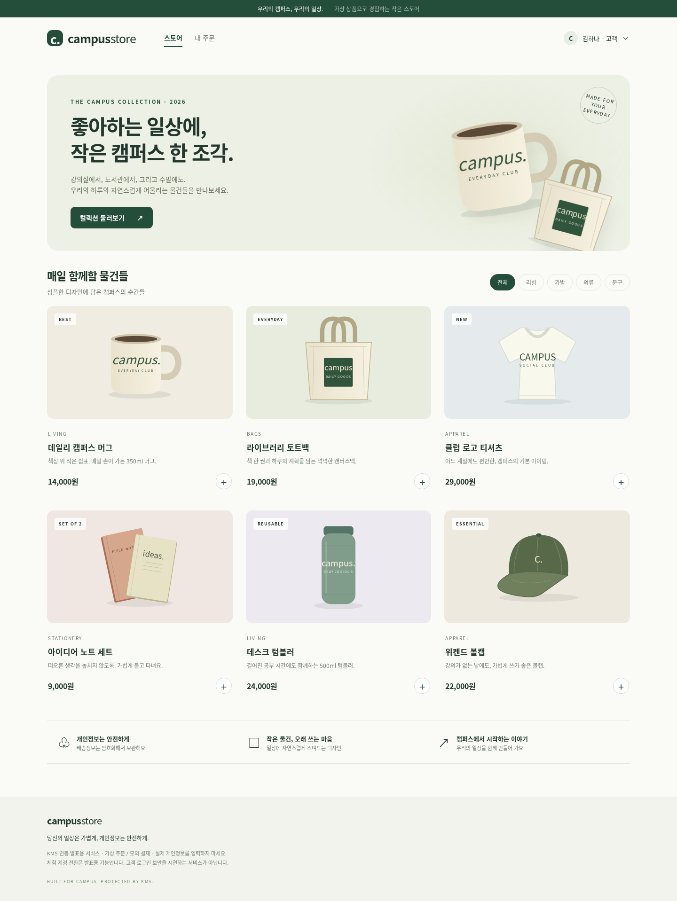

# Campus Store 검증 기록

최초 검증일: 2026-10-14 UTC. 공개 접속 경로 개정·검증: 2026-10-15 (한국 시간). [시나리오와 전체 구성](campus-store.md).

**현재 스토어 사용자 경로는 공개 HTTPS다. Tailscale 설치·가입 없이 접속 암호로 입장한다.** 앱 5개와 기존 KMS 연동을 유지하고 기존 Tailscale의 스토어 `/store` 경로는 제거했다. KMS 관리 경로는 기존 사설 경로로 유지한다.

## 2026-10-15 공개 경로 전환

| 항목 | 결과 | 근거 |
|---|---|---|
| 접속 인증 회귀 | PASS · 10개 단위 시험 | [로그](evidence/unit-tests-public.log). 접속 암호·HTTPS 이동·Tailscale 헤더 위조 거부·origin 파일 갱신·기존 기능 |
| 실제 공개 HTTPS API | PASS · 8개 시나리오 | [공개 운영 연동](evidence/campus-store-public-live.json). 합성 proxy 헤더 없이 실제 HTTPS와 Basic 인증으로 주문·복호화·403·변조·저장 검증 |
| Portal 재시작 지속성 | PASS | 새 공개 경로에서 만든 가상 주문의 ID와 복호화 결과 보존 |
| 공개 접속 인증과 TLS | PASS | [적용 결과](evidence/public-access.json). 실제 TLS 인증서 검증, 인증 성공 200, 인증 없는 요청 401. KMS JWT·내부 토큰은 브라우저에 보내지 않음 |
| 실제 공개 브라우저 | PASS | [Chromium 결과](evidence/public-browser.json). 일반 공개 IP로 연결, TLS 검증 유지, 새 주문·배송 조회·분석팀 403·지연된 세션 응답·모바일 배치 |
| 접근 경로 분리 | PASS | 기존 Tailscale /store 제거, 사설 관리 / 경로 보존. 공개 터널 upstream은 Portal 8300만 지정 |
| 최종 배포 상태 | PASS | [최종 확인](evidence/public-final-state.json). 이미지 `campus-store:16fa2d472b0b`, 앱 5개 Ready, 터널 서비스 active, 공개 HTML·JavaScript와 현재 소스 일치 |

공개 브라우저 결과와 화면은 아래 최신 증거를 참고한다. 이 검증은 서버에서 실행한 일반 Chromium이 실제 공개 HTTPS를 통과한 결과다. 별도 PC·휴대전화의 수동 접속 시험을 대신했다고 주장하지 않는다. 임시 URL은 재시작 시 바뀔 수 있으므로 `python3 deploy/campus-store/publish.py --status`로 현재 주소를 확인한다. 계정은 `demo`, 암호는 `~/kms-lab/campus-store/access-password`에만 보관한다.

처음 공개 HTTPS systemd 서비스를 시작할 때 호스트에 UID10001의 사용자 항목이 없어 `217/USER` 오류가 발생했다. 로그인 불가 전용 계정을 생성하고 설치 스크립트에 반영해 해결했다. 공개 브라우저 검증에서는 지연된 초기 세션 401이 새 계정 선택 후 도착하면 선택 창을 다시 여는 경합을 발견했고, 이전 로그인 세대의 응답을 무시하도록 보완했다.

### 공개 HTTPS에서 촬영한 실제 시연 화면

- [스토어](screenshots/public/01-storefront.png) · [주문 내역](screenshots/public/02-orders.png)
- [배송정보 조회](screenshots/public/03-shipping.png) · [판매 분석과 KMS 403](screenshots/public/04-analytics-denied.png)
- [보호 과정](screenshots/public/05-evidence.png) · [모바일](screenshots/public/06-mobile.png)

공개 경로로 가상 주문을 새로 생성했고, 기존 주문도 유지했다. 키 버전은 운영 키의 현재 버전을 사용하며 키 회전·최소 복호화 버전 변경은 하지 않았다. 이 화면에는 암호·KMS 토큰이 포함되지 않는다.

## 2026-10-14 최초 구현과 사설 경로 검증 이력

다음 표와 기존 JSON은 **공개 전환 이전의 증거**다. 현재 접속 방법이나 최신 이미지로 해석하지 않는다. 기존 결과를 덮어쓰지 않고 공개 경로 증거를 별도 파일로 추가했다.

### 최초 결과

| 항목 | 결과 | 근거·정확한 범위 |
|---|---|---|
| 단위 회귀 9개 | PASS | [로그](evidence/unit-tests.log). 저장, 역할 검사, 주문 바인딩, 오류 처리, HTTP Origin/CSRF/세션, 고정 작업·키. KMS 대역을 쓰는 앱 단위 시험 |
| 실제 KMS 코드 연결 | PASS · 격리 | [통합 결과](evidence/campus-store-local.json). 현재 저장소의 Transit·KeyManager·Barrier·JWT·SAR middleware 사용 |
| 주문 암호화·배송 복호화 | PASS · 격리 | checkout encrypt → SQLite → shipping decrypt, 주문 금액 서버 계산, 고객별 목록 분리 |
| 분석팀 권한 거부 | PASS · 격리 | 실제 KMS HTTP 403을 앱 화면까지 전달. **Kubernetes SAR backend는 모의 구현** |
| 내부 인증 실패 구분 | PASS · 격리 | 작업 서비스 토큰을 틀리게 했을 때 KMS 권한 거부로 표시하지 않음 |
| 변조·키 회전·rewrap·최소 버전 | PASS · 격리 | 변조 400, 회전 후 기존 데이터 200, DB를 v2로 교체, 최소 버전 2에서 v1 거부·v2 200 |
| seal/unseal | PASS · 격리 | 시험용 KMS만 seal → unavailable → unseal → 조회 성공. 운영 KMS 상태는 변경하지 않음 |
| 원문 영속 저장 방지 | PASS · 시험 데이터 범위 | DB 재연결로 주문 보존 확인, DB/WAL 바이트에서 시험용 배송정보 원문 부재 검사 |
| Chromium 화면 | PASS · 격리 | 브라우저로 주문 생성·배송 조회·분석팀 403·발표자 조회 수행. 창 닫은 뒤 지연 응답이 원문을 다시 채우지 않는지 확인 |
| 반응형·이미지·JS | PASS · 검증 viewport | 1440px 데스크톱과 390px 모바일, 가로 넘침 없음, 상품 이미지 decode 성공, JS 예외 없음 |
| 독립 Docker 이미지 | PASS · 로컬 | [이미지 검사](evidence/app-image.json). ARM64·UID10001·읽기 전용 rootfs·capability 제거·network none에서 앱 시작/healthz/SQLite 쓰기, 테스트 fixture 제외 |
| 배포 구성 | 실제 적용 완료 | namespace·SA·RBAC·PV/PVC·서비스·앱 5개, private /store 경로. [검토용 리소스](../../deploy/campus-store/resources.example.json)의 인증서·노드·토큰은 자리표시자 |
| 운영 KMS·Kubernetes RBAC 연결 | PASS | [운영 연동 8개 시나리오](evidence/campus-store-live.json): 실제 암복호화·분석팀 403·변조 400·DB 원문 부재·Portal Pod 교체 후 주문 보존 |
| 실제 서비스 권한 | PASS | [SubjectAccessReview 15개](evidence/live-permissions.json): 5개 SA × encrypt/decrypt/rewrap의 허용·거부 일치 |
| 운영 migration rewrap | PASS · 동일 버전 | [실제 rewrap](evidence/live-rewrap.json): v1 → v1 재암호화 결과의 복호화 원문 일치. 저장 암호문은 유지했고 키 회전·최소 버전 정책 변경은 하지 않음 |
| 사설 HTTPS /store | PASS · 호스트 확인 범위 | 시스템 CA·호스트명 검증 성공, 사용자 identity 없는 호스트 자체 접속 401, 기존 관리 / 경로 보존 |
| 실제 허용·비허용 기기 | NOT RUN | 사람의 tailnet 로그인과 다른 기기의 접근 제어는 별도 확인 필요 |

통합 결과의 10개 항목은 여러 assertion을 묶은 시나리오 수이며 단위 테스트 9개와 같은 단위의 개수는 아니다. 운영 KMS 재시작·키 회전·seal·최소 버전 변경은 수행하지 않았다. 로컬 이미지 검증과 별도로 앱 이미지 `campus-store:99ab3f34be6a`를 containerd에 반입하여 실제 배포했다. 최초 로컬 통합 JSON의 `production_deployment: NOT RUN`은 그 실행 당시의 기록이며, 이후 배포 상태는 운영 연동 JSON을 기준으로 한다.

검토 시점의 앱·배포 파일은 [SHA-256 목록](evidence/source-sha256.json)에 기록했다. 문서의 상대 링크와 오프라인 리소스 개수, 산출물에 개인키 PEM이 포함되지 않았음을 확인했다.

## 최초 격리 화면 증거

아래는 **격리 KMS와 가상 주문**으로 만든 화면이다. 배포된 운영 서비스 화면으로 발표하지 않는다. 주문 ID와 시각은 실행마다 달라진다.

| 화면 | 확인 내용 |
|---|---|
| [스토어](screenshots/01-storefront.png) | 상품 카탈로그, 분류, 장바구니 진입 |
| [내 주문](screenshots/02-orders.png) | 브라우저에서 생성한 주문과 배송 단계 |
| [배송 조회](screenshots/03-shipping.png) | 실제 복호화 결과로 표시된 가상 배송정보 |
| [판매 분석·403](screenshots/04-analytics-denied.png) | 판매 집계와 별도 서비스의 KMS 거부 |
| [보호 과정](screenshots/05-evidence.png) | 암호문 버전, 요청 결과, 재암호화 UI |
| [모바일](screenshots/06-mobile.png) | 390px 폭에서 상품과 메뉴 배치 |

## 최초 사설 배포와 문제 해결 이력

1. 최초 배포는 자동 승인 검토에서 실행 전에 차단되었다. 영구 리소스·키·사설 HTTPS 라우팅 변경에는 별도 운영 승인이 필요하다는 판단이었다.
2. 사용자가 **“검증 후 실제 클러스터에 적용”**을 선택한 후 전용 키, namespace·권한·저장소·앱 5개, `/store` 경로를 실제 적용했다.
3. 첫 주문에서 HTTP 503이 발생했다. Pod 기본 `ndots:5` 때문에 서비스 FQDN에 불필요한 검색 도메인이 붙어 DNS 조회가 약 6초 지연되었고, 중첩 호출의 8초 제한을 넘었다. 절대 DNS 이름 조회는 즉시 성공했다.
4. **campus-store Pod에만 `ndots=1`**을 설정하고 재배포했다. 기존 CoreDNS·KMS 설정은 변경하지 않았다. 후속 조회는 약 0.056초였으며 실제 주문·조회 검증을 통과했다.
5. Portal Pod를 교체하고 같은 주문 ID와 배송정보 조회가 유지됨을 확인했다. 기존 KMS·관리 콘솔·Prometheus는 Ready 상태다.

최초 배포 시 가상 고객 두 명의 주문을 만들었다. 당시 접속은 사설 HTTPS /store였으며 현재 이 경로는 제거되었다. 새 접속 주소는 `publish.py --status`로 확인한다.

최초 사설 경로의 운영 검증은 **호스트 loopback에서 합성 Serve 사용자 헤더를 전달한 요청**을 사용했다. 이는 신뢰된 프록시 경계 뒤의 앱·KMS·RBAC 경로 검증이다. 실제 HTTPS 호스트 자체 접속에서는 헤더를 위조하지 않았고, 인증 정보 부재로 401을 확인했다. 사람의 tailnet 로그인 성공이나 비허용 기기의 차단 시험을 통과했다고 주장하지 않는다.

키 회전·최소 버전 차단은 격리 환경에서 검증했다. 운영에서는 현재 키 버전으로 rewrap 가능한 것까지 확인했으며 `campus-shipping`의 정책을 바꾸지 않았다. 실제 발표에서 버전을 올릴 때는 [시연 순서](campus-store.md#4-발표-시연-순서--약-5분)를 따른다. 운영 KMS seal은 수행하지 않는다.

기존 KMS·관리 콘솔·Prometheus의 실행 설정 및 기존 사용자의 미커밋 작업은 이 앱 구현에서 변경하지 않았다. 기존 release 검증 문서에는 T15의 현재 결과와 이 기록의 링크만 반영했다. 앱과 문서는 아직 새 Git 릴리스로 커밋하지 않은 작업 파일이다.
