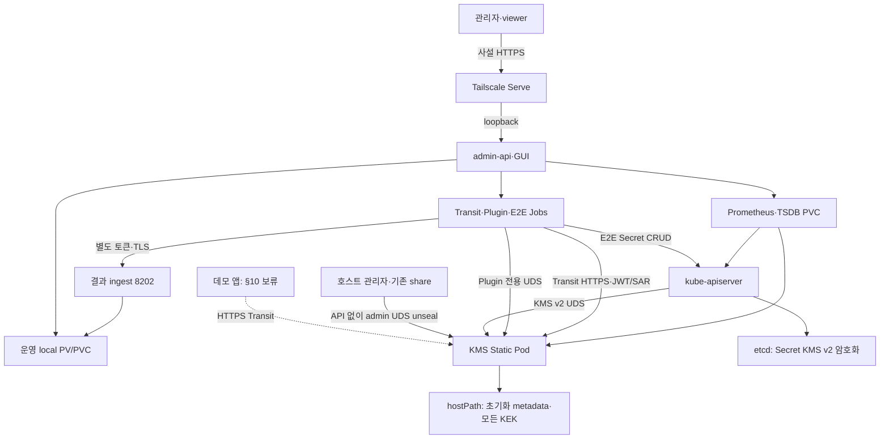

# 단일 노드 최종 구성

2026-10-12 KST, 현재 관측한 배치 기준. 제품은 server/admin-api/bench 세 이미지이며 자체 데모 앱은 별도 이미지다. 데모 앱의 배포·시나리오는 사용자가 보류한 §10 범위이므로 아래에서 미배포로 표시한다.

| 가이드 요소 | 실제 배치·상태 |
|---|---|
| 관리 접근 | 기존 사설 Tailscale Serve 유지. 관리 공개 NodePort/Funnel 추가 없음 |
| KMS v2 | 공식 v0.35.9 RPC, apiserver 1.35.9 연결, custom-kms provider |
| Secret | identity 제거, 현재 전체 Secret raw prefix와 실제 envelope key ID 확인 |
| 저장 | 키 hostPath, 운영 데이터·Prometheus 각각 local PV/PVC |
| 벤치 | 고정 Job 템플릿, 세 모드 각각 identity/KMS 조건에서 3회 실제 실행 |
| Plugin 권한 | KMS UDS 접근이 있는 강한 권한의 시험. Transit/E2E와 분리 |
| 복구 | 호스트 UDS Shamir unseal, 정지 백업, 별도 경로 복원. 실행 증거는 verification.md |
| 데모 앱 | 별도 소스·템플릿 존재, 배포와 시나리오는 보류 |

하나의 Boot Volume과 커널을 공유한다. local PV/PVC는 HA나 물리 디스크 장애 격리를 제공하지 않는다. 호스트 root와 hostNetwork/hostPath 워크로드 생성 권한은 신뢰 경계 안이다.
