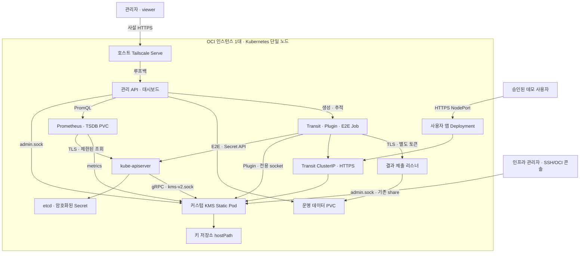

# OCI 인스턴스 한 대에서 KMS-system 구축·검증하기 — rev2

**최종 제출용 구현·배포·검증 가이드 / rev1의 5.1 완료 지점에서 이어가기**

> 개정일: 2026-10-11 KST. 기준 문서: `02_KMS_single_instance_guide_rev1.md`.
> 아키텍처 기준: 사용자가 제공한 `mermaid-diagram (1) (1)(1).png`.
> 원본 분석 커밋: `055e84d2b6cea508c7622bfaf639f08e46021dd8`.
> 이번에 직접 확인한 개인 저장소: `https://github.com/kyum0731/KMS-system-oci-lab`, HEAD `34a37352b64c9028c431d523941c517f165feb67`.
> 소스 열람 기준과 사용자의 OCI 작업 트리는 같다고 가정하지 않는다. 실제 배포 SHA는 5.2에서 기록한다.
>
> 이 문서는 완성 목표와 실행 절차를 개정한 것이며, 저장소 코드나 OCI 인스턴스를 대신 수정·배포한 결과가 아니다. 아래 **신규 구현 계약**은 실제 코드·테스트를 완성한 후에만 사용할 수 있다. 문서 작성 완료와 프로젝트 구현 완료를 구분한다.

### rev2의 결정과 적용 범위

- **지금 시작할 곳은 5.2다.** 2절부터 5.1까지는 rev1 본문과 명령을 그대로 보존했다. 다시 clone, 브랜치 전환, kubeadm init, containerd 재설정을 하지 않는다.
- 0·1절은 같은 제목을 유지하면서 최종 목표 설명과 구성도를 갱신했다. 이미 수행한 설치를 되돌리라는 뜻이 아니다.
- KMS 제품 이미지 3개: `kms-server`, `kms-admin-api`, `kms-bench`. 한 이미지에 세 바이너리를 복사하지 않는다.
- PNG의 Prometheus, 운영 데이터 PVC, 감사 기록, 실제 Job 제어·결과 제출, 데모 앱, Transit HTTPS, Plugin/E2E 시험, KMS v2를 **필수 완성 범위**로 넣는다.
- 관리 접속은 rev1에서 확정한 **Tailscale Serve 사설 HTTPS**를 유지한다. PNG의 관리 NodePort를 새로 공인 노출하지 않는다. 이것이 PNG에서 의도적으로 유지하는 접근 계층 차이다.
- 키 저장소는 KMS Static Pod의 hostPath, 운영 데이터와 Prometheus는 각각 local PV/PVC다. PVC로 바꿔도 같은 Boot Volume의 단일 장애점은 없어지지 않는다.
- 데이터 보호·GUI 인가·TLS를 처음 배포하기 전에 구현한다. 인증을 끈 채 먼저 배포하고 마지막에 보안 기능을 덧붙이는 순서는 폐기한다.
- 최종 제출은 **신뢰된 인프라 관리자가 운영하는 단일 노드** 범위다. HA·멀티테넌트·하드웨어 Root 보호·무인 unseal을 달성했다고 주장하지 않는다.

### 권장 실행 순서

| 순서 | 실제 작업 | 통과 기준 |
|---|---|---|
| 이미 완료 | 2~5.1 | 기존 설치·작업 트리 보존 |
| 5.2 | 현재 상태 점검 → 필수 코드 보완 → 계약 테스트 | 미지원 설정/경로가 없고 보안·내구성 테스트 통과 |
| 5.3~5.5 | 세 이미지 빌드·검사·등록·버전 고정 | ARM64, 바이너리 분리, 이미지 목록 저장 |
| 6 | 디렉터리·PVC·인증서·SAR·ServiceAccount 준비 | bootstrap 자격증명은 호스트에 존재 |
| 7~9 | KMS·관리 API·HTTPS·Prometheus → 최초 초기화 | 인증 항상 켜짐, 기존 데이터 재init 금지 |
| 10~11 | 데모 앱·세 종류 벤치 Job·결과 수집 | 권한 분리, GUI로 실제 Job 생성·조회 |
| 12 | KMS v2 호환 시험 → apiserver 연결 → 기존 Secret 재쓰기 | raw etcd 암호화·회전·재시작 증거 |
| 13~16 | 백업·복원·회귀·성능·시연·제출 | 미완료 항목을 숨기지 않는 증거 묶음 |

18절은 이 문서대로 실제 코드를 완성하도록 VS Code Codex에 전달할 지시문이다. 5.2에서 곧바로 사용할 수 있다.

## 0. 이번에 만들 수 있는 것과 추가 개발할 것

현재 확인한 코드에는 Transit HTTP, 관리 UDS, Shamir, 파일 저장, ServiceAccount JWT/SAR, 직접 metrics 수집 대시보드, Transit 벤치마크가 있다. 다음은 문서 편집만으로 생기지 않는다.

| 실제 확인 근거 | 현 상태/위험 | rev2 필수 보완 |
|---|---|---|
| `Dockerfile` | `cmd/server` 하나만 빌드 | 세 타깃/세 이미지 |
| `internal/storage/file.go` | `os.WriteFile` 직접 덮어쓰기 | 같은 디렉터리 임시 파일·fsync·rename·디렉터리 fsync, 오류 전달 |
| `internal/keys/manager.go` | read-modify-write 전체 잠금 없음 | 키별 작업 잠금, 단일 프로세스 저장소 락 |
| `internal/api/admin/admin.go`, `internal/seal/shamir.go` | 최초 init 영속 기록·복원 Root 검증 부족 | 영속 초기화 기록, 재init 거부, 검증 레코드, 잘못된 share 거부 |
| `cmd/server/main.go` | 수동 unseal 후 scheduler 시작 미연결 | unseal/seal 생명주기와 회전 연결 |
| `cmd/server/main.go` | Transit plain HTTP, KMS v2 리스너 없음 | Transit TLS, 독립 KMS v2 UDS |
| `internal/adminapi/router.go` | `/v1/*` 포괄 프록시, 사람별 인가 없음 | 라우트 허용 목록, Tailscale 신원, admin/viewer, CSRF |
| `internal/dashboard/*` | 직접 scrape·메모리 시계열, 결과 파일 | Prometheus 조회, 운영 PVC, 작업 상태·감사 영속화 |
| `cmd/bench/main.go`, `internal/bench/submit.go` | Transit만 시험, 제출 실패 경고, 제출 인증 없음 | Transit/Plugin/E2E 구분, 별도 제출 인증·TLS·실패 상태 |
| `internal/api/portal/*` | 사용 앱 라우트가 관리 API에서 제외 | 독립 데모 앱 이미지·Deployment |
| `internal/api/transit/transit.go` | `seal-benchmark` GET가 인증 사용자에게 노출, 자원 사용 작업 | 최종 운영 라우터에서 제거하고 격리된 비교 Job으로 이동 |

원본 주석에 단순화/후속 작업이라고 적힌 부분도 실제 구현과 대조했다. README의 주장만으로 완료 처리하지 않는다. 현재 HEAD에서 KMS v2 패키지·Job 컨트롤러가 없는 상태를 기준으로 작성했으며, 이후 OCI 코드가 바뀌면 5.2의 코드 감사표를 갱신한다.

## 1. 한 인스턴스 안의 최종 배치

| 구성요소 | 최종 배치 | 데이터/접근 |
|---|---|---|
| containerd·kubelet·Tailscale | 호스트 서비스 | 기존 설치 유지 |
| Kubernetes control plane·etcd | kubeadm Static Pod | apiserver만 KMS v2 socket 연결 |
| KMS server | `kms-server`, Static Pod, hostNetwork, 1개 | keys hostPath, admin.sock, kms-v2.sock |
| 관리 API·웹 UI | `kms-admin-api`, Deployment, hostNetwork, 1개 | 127.0.0.1:8201, 운영 PVC, admin.sock |
| 결과 제출 리스너 | 같은 admin-api 프로세스의 별도 HTTPS :8202 | **결과 업로드 경로만** 등록, Job 토큰 인증 |
| Prometheus | 공식 이미지, Deployment, hostNetwork, 1개 | 127.0.0.1:9090, TSDB PVC, 서버 localhost metrics 수집 |
| Transit 벤치 | `kms-bench`, 일반 Job | TLS·ServiceAccount, 소켓/키 마운트 없음 |
| Plugin 벤치 | 같은 `kms-bench` 이미지, 전용 Job | KMS v2 socket만 마운트; 강한 권한으로 별도 분류 |
| E2E 벤치 | 같은 `kms-bench` 이미지, 일반 Job | 전용 namespace Secret만 CRUD |
| 사용자 데모 앱 | 별도 `kms-demo-app` 이미지, Deployment | NodePort의 HTTPS → 서버 측 Transit 호출 |
| 운영 저장 | local PV/PVC 2개 | 결과·작업·감사 / Prometheus TSDB 분리 |

**세 이미지라는 말은 KMS 제품의 세 프로그램을 뜻한다.** PNG의 사용자 앱은 별도 프로그램이므로 네 번째 자체 이미지가 필요하고, Prometheus는 공식 이미지를 쓴다. 이미지 수를 세 개로 맞추기 위해 데모 앱이나 Prometheus를 KMS 서버에 합치지 않는다. 웹 정적 자산과 관리 API는 같은 배포 단위로 유지한다. UI를 무조건 별도 컨테이너로 분리하는 것은 PNG의 논리 블록을 지키기 위한 필수 조건이 아니다.



### 1.1 첨부 PNG와 달라지는 부분

| PNG 요소 | rev2 대응 | 일치/명시적 차이 |
|---|---|---|
| 관리 NodePort·HTTPS | Tailscale Serve → 루프백 관리 Deployment | **rev1에서 확정한 접근 방식 유지**, 공인 관리 NodePort 없음 |
| 앱 NodePort·HTTPS | HTTPS NodePort 30443, 승인 사용자만 tailnet에서 접근 | 앱 요소 구현. 불특정 인터넷 공개는 범위에 넣지 않음 |
| 관리 API·대시보드 | 동일 이미지의 서버와 embedded 웹 UI | 논리 기능 모두 구현, 별도 UI 이미지 불필요 |
| Job 제어·결과 제출 | API의 제한된 Job 생성기와 TLS ingest | 수동 로그 복사로 대체하지 않음 |
| Prometheus | 공식 서버 + TSDB PVC | 기존 임시 직접 수집을 대체 |
| 결과·작업·감사 PVC | local PV/PVC | 영속화 포함, 단일 디스크 한계 명시 |
| Transit HTTPS | 사설 CA 인증서와 SA JWT | HTTP 예시 폐기 |
| Plugin·E2E 시험 | 별도 모드·권한·결과 지표 | Transit 속도와 혼동하지 않음 |
| apiserver·KMS v2·etcd | 실제 RPC 구현 + raw etcd 검증 | 필수 제출 항목 |
| 키 hostPath | 유지 | Static Pod가 API/PVC 없이 부팅해야 함 |

관리 UI와 Prometheus를 hostNetwork에 두는 이유는 단순 임시 구성이라는 이유가 아니라, **루프백 접속 경계와 호스트 UDS를 사용하는 단일 노드 설계**다. 일반 팀원은 hostNetwork/hostPath Pod를 생성할 수 없다. 악성 Pod 격리까지 주장하려면 별도의 CNI 정책 강제·호스트 방화벽 검증이 필요하며, 기존 Flannel이 NetworkPolicy를 강제한다고 적지 않는다.

이하 2~5.1은 기존 수행 이력을 보존한 원문이다. 앞부분의 과거 14.4 참조는 rev1 당시 안내이며, rev2에서는 5.2·8절에서 이미 구현·검증한다. 재실행하지 말고 5.2로 이동한다.

## 2. 먼저 접속과 네트워크를 준비한다

### 2.1 OCI 콘솔에서 확인

- Ubuntu 24.04, ARM64인지 확인한다.
- 공인 IP, VNIC 사설 IP, 부트 볼륨 크기, 실제 OCPU/RAM을 기록한다.
- 인바운드는 SSH TCP 22를 본인 공인 IP `/32`에 한정한다.
- 관리 화면 8201, Transit 8200, metrics 9100, etcd 2379/2380은 인터넷에 개방하지 않는다.
- **관리 GUI용 공인 TCP 80/443 및 NodePort 대역도 열지 않는다.** Tailscale 내부 TCP 443 허용과 OCI 공인 IP의 443 개방은 다른 설정이다.
- VNIC에 IPv6가 있으면 IPv6 인바운드도 같은 원칙으로 점검한다.
- 기존의 넓은 NSG/Security List 허용 규칙이 별도로 있는지 확인한다. 좁은 규칙을 추가해도 기존 전체 허용이 상쇄되지는 않는다.
- Kubernetes API 6443도 이 가이드에서는 SSH 후 원격 터미널에서 쓰므로 인터넷 개방이 필요 없다.
- 패키지·GitHub·컨테이너 레지스트리·Tailscale 제어/중계·인증서 발급에 필요한 아웃바운드와 DNS를 확인한다. 별도 outbound 제한이 있으면 공식 연결 요구사항을 확인한다.

NSG/Security List와 Ubuntu 내부 방화벽은 별개다. 이후 Pod 통신 오류가 나면 양쪽을 확인한다. 기존 SSH 규칙을 무턱대고 flush하거나 방화벽을 전부 해제하지 않는다.

### 2.2 Windows SSH 설정

`C:\Users\<사용자>\.ssh\config`에 작성한다. 키 파일은 이미 인스턴스 생성에 사용한 개인키 경로다.

```sshconfig
Host kms-oci
    HostName <OCI_PUBLIC_IP>
    User ubuntu
    IdentityFile C:/Users/<사용자>/.ssh/oci-kms.key
    IdentitiesOnly yes
    ServerAliveInterval 30
    ServerAliveCountMax 3
```

PowerShell에서 `ssh kms-oci`가 되는지 확인한다. VS Code에 Remote - SSH를 설치하고 `Remote-SSH: Connect to Host...`에서 `kms-oci`를 선택한다. 이후 이 문서의 Bash 명령은 모두 **원격 Ubuntu 터미널**에서 실행한다. Windows 로컬 PowerShell에서 apt/kubeadm 명령을 실행하는 것이 아니다.

### 2.3 원격 환경 확인

```bash
uname -m
cat /etc/os-release
nproc
free -h
df -h /
ip -4 addr
lsblk -f
```

기대값: `aarch64`, Ubuntu 24.04, 계획에 맞는 CPU/RAM/디스크. 이미 Kubernetes가 있으면 아래 신규 설치 대신 `kubectl get nodes -o wide`, `sudo crictl ps`, `/etc/kubernetes/manifests`를 점검한다. 기존 데이터가 있는데 `kubeadm reset`을 실행하지 않는다.


### 2.4 관리 계정과 권한을 먼저 정한다

- Tailscale tailnet은 프로젝트용으로 분리하는 것을 기본으로 한다. 관리자는 본인 개인 계정으로 소유/정책을 관리하고, 팀원은 각자 계정을 사용한다.
- 로그인 제공자의 MFA를 활성화한다. Tailscale 정책 변경 권한과 KMS `admin` 권한은 별개다. 일반 팀원에게 tailnet 관리자나 태그 소유 권한을 주지 않는다.
- `infra-admin`: SSH·sudo·kubeconfig·배포를 맡는 소수 담당자. `kms-admin`: 키 운영 담당자. `viewer`: 대시보드 조회 담당자. 최초 한 명이 앞의 두 역할을 겸해도 된다.
- **viewer에게 SSH 키, ubuntu 공용 계정, admin.conf, sudo, Docker 그룹, hostPath/hostNetwork Pod 생성 권한을 주지 않는다.** 이 권한은 루프백·소켓·호스트 접근을 통해 GUI 제한을 우회할 수 있다.
- 팀원 PC는 사람 계정 소유 기기로 등록한다. 서버용 태그를 팀원 PC에 붙이지 않는다. 14.4의 사용자 식별은 사람 계정을 전제로 한다.
- 당장은 관리자만 접속 허용한다. 팀원 초대·기기 등록 자체와 GUI 443 접근 허용은 나누고, 후자는 14.4 검증 후 적용한다.

프로젝트와 이 MD를 VS Code 원격 작업 폴더에서 열고, Codex에는 “현재 코드와 이 문서의 미구현 항목을 구분하고, 단계별 확인 결과를 기록하며 진행”하도록 요청한다. 실제 서비스 로그인·MFA·Shamir share 입력은 사람이 수행한다.

## 3. 호스트와 containerd를 설치한다

이 절의 containerd 설정 생성은 **새 인스턴스** 기준이다. 기존 설정이 있다면 먼저 백업·비교한다.

```bash
sudo apt-get update
sudo apt-get install -y ca-certificates curl gnupg git jq openssl python3 \
  build-essential pkg-config libssl-dev containerd docker.io
sudo systemctl enable --now docker
sudo swapoff -a
```

`/etc/fstab`에 swap 항목이 있으면 해당 항목만 주석 처리하고 `swapon --show`가 비어 있는지 확인한다. 다른 디스크 마운트 항목은 수정하지 않는다.

```bash
cat <<'YAML' | sudo tee /etc/modules-load.d/k8s.conf
overlay
br_netfilter
YAML
sudo modprobe overlay
sudo modprobe br_netfilter
cat <<'CONF' | sudo tee /etc/sysctl.d/99-kubernetes.conf
net.bridge.bridge-nf-call-iptables = 1
net.bridge.bridge-nf-call-ip6tables = 1
net.ipv4.ip_forward = 1
CONF
sudo sysctl --system
sudo mkdir -p /etc/containerd
```

새 환경에서만 기본 설정을 생성한다.

```bash
containerd config default > /tmp/containerd-kms.toml
sed -i 's/SystemdCgroup = false/SystemdCgroup = true/g' /tmp/containerd-kms.toml
sudo install -m 644 /tmp/containerd-kms.toml /etc/containerd/config.toml
sudo systemctl enable containerd
sudo systemctl restart containerd
containerd --version
sudo systemctl --no-pager status containerd
```

확인할 것:

- containerd CRI plugin이 활성화되어야 한다. `disabled_plugins`에 `cri`가 있으면 원인을 확인하고 제거한다.
- containerd 1.x/2.x는 설정 섹션 이름이 다르다. 설치된 바이너리의 `config default`에서 만들었는지 확인한다.
- `SystemdCgroup = true`가 실제 runc options에 반영되었는지 확인한다.
- Docker는 이미지 빌드 도구이고 Kubernetes 런타임은 containerd다. Docker가 이미지를 갖고 있어도 Kubernetes용 namespace에 자동 등록되지 않는다.

## 4. kubeadm으로 단일 노드 클러스터를 만든다

### 4.1 Kubernetes 버전

이 예시는 Kubernetes **1.35 계열의 설치 시점 최신 패치**를 사용한다. 조회한 공식 릴리스 문서에서 1.35 지원 종료는 2027-02-28이다. 이후 실행한다면 지원 중인 minor와 저장소 의존성을 다시 확인한다. 현재 프로젝트 client-go는 v0.32.13이므로 1.35와 동일 minor 조합은 아니며, 사용하는 v1 SAR/Secret API의 실제 통합 시험이 필요하다. 버전 차이를 감추지 말고 기록한다.

```bash
sudo mkdir -p -m 755 /etc/apt/keyrings
curl -fsSL https://pkgs.k8s.io/core:/stable:/v1.35/deb/Release.key \
  | sudo gpg --dearmor -o /etc/apt/keyrings/kubernetes-apt-keyring.gpg
cat <<'APT' | sudo tee /etc/apt/sources.list.d/kubernetes.list
deb [signed-by=/etc/apt/keyrings/kubernetes-apt-keyring.gpg] https://pkgs.k8s.io/core:/stable:/v1.35/deb/ /
APT
sudo apt-get update
sudo apt-get install -y kubelet kubeadm kubectl
sudo apt-mark hold kubelet kubeadm kubectl
sudo systemctl enable kubelet
kubeadm version -o short
```

### 4.2 init

아래 값을 OCI VNIC의 **사설 IPv4**로 바꾼다. Pod CIDR `10.244.0.0/16`, Service CIDR 기본 `10.96.0.0/12`가 VCN 및 다른 사용 네트워크와 겹치지 않는지 먼저 확인한다. 겹치면 CNI 설정까지 함께 바꿔야 한다.

```bash
KMS_NODE_IP='<OCI_PRIVATE_IP>'
printf '%s\n' "$KMS_NODE_IP"
sudo kubeadm init \
  --apiserver-advertise-address="$KMS_NODE_IP" \
  --pod-network-cidr=10.244.0.0/16 \
  --cri-socket=unix:///run/containerd/containerd.sock
mkdir -p "$HOME/.kube"
sudo install -m 600 -o "$(id -u)" -g "$(id -g)" \
  /etc/kubernetes/admin.conf "$HOME/.kube/config"
```

`admin.conf`는 관리자 자격증명이다. 이 파일을 KMS 컨테이너나 앱에 마운트하지 않는다.

### 4.3 CNI와 단일 노드 스케줄링

Flannel 공식 배포 파일을 로컬로 내려받아 사용 이미지 버전을 기록한 다음 적용한다. 최신 릴리스 URL은 변할 수 있으므로, 받은 파일을 보관하여 재실험에 그대로 사용한다.

```bash
mkdir -p "$HOME/kms-lab/infra"
curl -fL https://github.com/flannel-io/flannel/releases/latest/download/kube-flannel.yml \
  -o "$HOME/kms-lab/infra/kube-flannel.yml"
sha256sum "$HOME/kms-lab/infra/kube-flannel.yml"
rg 'image:' "$HOME/kms-lab/infra/kube-flannel.yml" 2>/dev/null \
  || grep 'image:' "$HOME/kms-lab/infra/kube-flannel.yml"
kubectl apply -f "$HOME/kms-lab/infra/kube-flannel.yml"
kubectl taint nodes --all node-role.kubernetes.io/control-plane-
kubectl get nodes -o wide
kubectl get pods -A -o wide
```

노드 `Ready`, CoreDNS 및 Flannel 정상 상태가 완료 기준이다. 이미 taint가 없다는 오류는 다시 제거할 대상이 없다는 뜻이다. Flannel만으로 NetworkPolicy를 강제한다고 가정하면 안 된다. 이 실습은 신뢰할 수 있는 단일 사용자 클러스터이며 다중 사용자 격리는 별도 정책 구현이 필요하다.

`cni plugin not initialized`/CoreDNS Pending이면 먼저 CNI 로그, br_netfilter, IP forwarding, 방화벽·네트워크 CIDR을 확인한다. KMS 배포로 넘어가서 원인을 섞지 않는다.

## 5. 저장소 확보와 ARM64 이미지 만들기

### 5.1 소스와 작업 브랜치

```bash
mkdir -p "$HOME/workspace"
cd "$HOME/workspace"
git clone https://github.com/Graduation-Project-k8s-2026/KMS-system.git
cd KMS-system
git status --short
git log -1 --oneline
# 이 문서를 정확히 재현할 경우 아래 기준에서 새 브랜치를 만든다.
git switch -c infra/oci-single-node 055e84d2b6cea508c7622bfaf639f08e46021dd8
mkdir -p deploy/oci-single-node
```

이미 작업한 checkout이 있으면 새 clone이나 branch 전환으로 덮어쓰지 말고 상태를 먼저 확인한다. 최신 main을 쓰려면 본 문서의 경로·변수·라우트가 동일한지 다시 확인한다. 문서 3개를 저장소의 `docs/review/`에 복사해 두면 VS Code Codex가 함께 읽을 수 있다.

### 5.2 최종 배포 전 코드 보완과 재개 지점 확인

**여기부터 새로 진행한다.** 이 단계는 Dockerfile 한 개를 붙여 넣는 작업에서, 최종 배포에 필요한 코드를 먼저 완성하는 단계로 바뀌었다. 기존 코드에 새 환경변수를 추가하기만 하고 다음 단계로 넘어가면 안 된다.

#### 5.2.1 기존 작업을 보존하며 상태 확인

원격 Ubuntu의 현재 프로젝트 폴더에서 실행한다. 폴더를 다른 곳에 두었다면 현재 경로를 사용한다.

```bash
cd "$HOME/workspace/KMS-system"
git status --short
git branch --show-current
git log -1 --oneline
git remote -v
uname -m
kubectl get nodes -o wide
kubectl get pods -A
sudo systemctl is-active containerd kubelet docker
mkdir -p deploy/oci-single-node docs/review docs/release scripts
mkdir -p "$HOME/kms-lab/evidence" "$HOME/kms-lab/releases"
git rev-parse HEAD > "$HOME/kms-lab/evidence/start-sha.txt"
kubectl version -o yaml > "$HOME/kms-lab/evidence/kubernetes-version.yaml"
```

개인 저장소로 이력을 정리했다면 원본 커밋이 로컬에 없을 수 있다. 원본 SHA로 checkout하거나 강제로 pull/reset하지 않는다. origin 변경·Git 이력 초기화도 다시 하지 않는다. 현재 파일 내용 기준으로 수정한다. `module github.com/Graduation-Project-k8s-2026/KMS-system`은 저장소 URL 변경만으로 바꿀 필요가 없다. module을 바꾸려면 import도 함께 수정해야 하므로 이 작업과 섞지 않는다.

키 파일이나 기존 Pod가 이미 있다면 아래 새 저장소 초기화를 적용하기 전에 13절 백업을 수행한다. 사용자 진술상 5.1 완료 상태를 기준으로 하지만, 검사 결과가 더 진행된 상태라면 기존 데이터를 우선한다.

#### 5.2.2 필수 구현 묶음과 완료 기준

다음 표는 **실제 소스 수정 작업**이다. 테스트 이름·신규 경로는 구현 시 만드는 계약이고, 현재 존재한다고 가정하지 않는다. 18절 지시문을 이용하되 완료 결과를 직접 확인한다.

| 묶음 | 수정/추가 지점 | 구현 조건 | 통과시킬 시험 |
|---|---|---|---|
| G1 초기화/Root | seal, barrier, admin init/unseal | 저장소 ID·format version·parts/threshold·Root 검증용 AEAD 레코드 영속화. Root/share 원문 저장 금지 | 재부팅 후 재init 409, 다른 초기화 세트 share/중복 좌표/오염 share로 unseal 실패, 올바른 share 복구 |
| G2 저장/동시성 | storage, keys | 원자적 저장과 내구성, 디렉터리 0700/파일 0600, 경로 탈출·symlink 방어, 저장소 프로세스 락 | 강제 종료·디스크 full·read-only 오류, 중복 create/동시 rotate/config에서 유실 없음, 두 번째 server 저장소 열기 실패 |
| G3 생명주기 | server, rotation | 수동 unseal 성공 후 scheduler 한 번 시작, seal/종료 시 중단. 진짜 last-unseal 이벤트 기록 | 중복 unseal에도 단일 scheduler, 회전 후 이전 암호문 복호화 |
| G4 서버 통신 | server, transit | TLS1.2 이상, 인증서 필수, HTTP fallback 금지, 시간 제한·본문 제한, 인증/인가 기본 on | CA 불신/만료/잘못된 SAN 차단, 401/403, 서버 종료 시 요청 정리 |
| G5 KMS v2 | 신규 internal/kmsv2, server | 공식 v2 gRPC Status/Encrypt/Decrypt, 독립 UDS, 전용 보호 키 | 고정 시험 벡터·RPC 호환·회전 경합·재시작 후 복호화, API 서버 부재에도 UDS 시작 |
| G6 관리 권한 | adminapi, GUI | 신원·명시 역할·route allowlist·Origin/CSRF·민감 응답 no-store | viewer 직접 쓰기 403, 헤더 없는 401, 위조 헤더/잘못된 Origin 거부 |
| G7 작업 제어 | 신규 admin Jobs service, bench | 고정 템플릿·모드별 SA, 영속 run ID·상태, 취소·재조정 | 서버 재시작 후 중복 Job 없음, 제출과 상태 복구, 임의 YAML/command/URL 거부 |
| G8 제출/결과 | admin ingest, bench submit | 별도 TLS 리스너·전용 audience 토큰, 실행 ID에 귀속, 스키마 제한·멱등 저장 | 잘못된 SA/audience/run ID 거부, 재시도 중복 없음, 업로드 실패가 완료로 표시되지 않음 |
| G9 관측/감사 | dashboard, metrics | Prometheus 조회, PVC 감사/결과/작업, 오류·sealed·auth 거부 지표 | Pod 재시작 후 결과/감사 유지, Prometheus 장애는 N/A, 비밀정보 로그 없음 |
| G10 사용자 앱 | 신규 cmd/demo-app 등 | 서버 측 Transit 호출, 브라우저에 SA 토큰 없음, 허용 키 고정 | 암호화/복호화·권한 거부·TLS·에러 화면, 비밀값 브라우저 저장 금지 |

G1의 초기화는 두 요청이 동시에 성공하면 안 된다. share를 사용자에게 반환하기 전에 초기화 레코드가 디스크에 확정되어야 한다. 확정 후 응답 유실 시 share를 다시 발급하는 기능으로 우회하지 않는다. 새 빈 저장소 초기화의 응답 유실 복구 정책을 별도로 문서화하고, 기존 데이터가 있으면 재init을 절대 자동화하지 않는다.

G2는 개별 파일 rename만으로 여러 파일 트랜잭션이 된다는 뜻이 아니다. init 검증 레코드와 metadata를 하나의 원자적 문서로 묶거나 journal/commit marker를 설계한다. 기존 파일 형식을 유지하는 기본안을 사용하되 필요한 데이터 migration은 버전별로 수행한다. bbolt/SQLite로 변경할 경우 이 문서의 백업·경로·호환 시험도 함께 바꾼다. 단일 서버 프로세스 락과 키 단위 잠금은 서로 다른 문제를 해결한다.

G5는 Transit의 JWT/SAR 경로를 거치지 않고 내부 키 관리 계층을 직접 사용한다. KMS v2가 동일 apiserver의 SAR/Secret을 호출해야 복호화할 수 있게 만들면 순환 의존이 생긴다. Root도 이 클러스터의 암호화 대상 Secret에 저장하지 않는다. Shamir 호스트 복구가 기본이다.

KMS v2 KEK는 `k8s-secrets`처럼 전용 이름을 예약하고 일반 앱 Role에서 접근을 허용하지 않는다. 일반 키 삭제/최소 복호화 버전 변경 API로 과거 Kubernetes 데이터를 읽지 못하게 만들지 않는다. 전용 KEK 회전·보존 정책을 분리한다.

#### 5.2.3 신규 설정 계약 — 구현 후 사용하는 이름

아래 이름은 rev2가 정하는 **신규 인터페이스**다. 기존 환경변수와 신규 변수를 혼동하지 않도록 `docs/release/config-contract.md`에 실제 지원 여부를 기록한다. 코드가 이 계약을 다르게 구현하면 Dockerfile/YAML/검증 스크립트를 함께 변경하고 문서와 맞춰야 한다.

| 프로그램 | 신규 설정 | 의미 |
|---|---|---|
| server | `KMS_TRANSIT_TLS_CERT`, `KMS_TRANSIT_TLS_KEY` | Transit 서버 인증서/키 |
| server | `KMS_V2_SOCKET`, `KMS_V2_KEY_NAME` | KMS v2 UDS, 전용 KEK 이름 |
| server | `KMS_AUDIT_DIR` | 호스트 UDS 직접 관리 이벤트 기록 위치 |
| admin-api | `ADMIN_API_AUTH_MODE=tailscale` | 신원 없는 관리 요청 거부 |
| admin-api | `ADMIN_API_ROLES_FILE`, `ADMIN_API_PUBLIC_ORIGIN` | 역할과 Host/Origin 허용 값 |
| admin-api | `ADMIN_API_DATA_DIR` | `/admin-data` 아래 작업·감사·결과 |
| admin-api | `ADMIN_API_PROMETHEUS_URL` | 직접 scrape 대신 PromQL 조회 |
| admin-api | `ADMIN_API_JOB_NAMESPACE`, `ADMIN_API_PLUGIN_NAMESPACE`, `ADMIN_API_E2E_NAMESPACE` | 고정 Job 대상 namespace |
| admin-api | `ADMIN_API_BENCH_IMAGE` | 생성할 Job의 검증된 이미지 참조 |
| admin-api | `ADMIN_API_INGEST_ADDR`, `ADMIN_API_INGEST_TLS_CERT`, `ADMIN_API_INGEST_TLS_KEY` | 별도 결과 제출 HTTPS 리스너 |
| admin-api | `ADMIN_API_INGEST_AUDIENCE=kms-bench-results` | TokenReview의 요구 audience |
| bench | `--mode=transit|plugin|e2e` | 실제 측정 계층 구분 |
| bench | `--ca-file`, `--submit-ca-file`, `--submit-token-file` | Transit TLS 및 별도 결과 제출 인증 |
| bench | `--run-id`, `--submit-required` | 결과 귀속과 제출 실패 종료 코드 |
| bench | `--kms-socket`, `--namespace` | Plugin 또는 E2E 모드 전용 설정 |

`ADMIN_API_METRICS_URL`은 기존 직접 수집용 변수다. 최종 배포에서는 비우고 새 Prometheus 조회 구현을 사용한다. 이름만 바꾸는 것으로 PromQL 조회가 구현되지는 않는다.

기존 `--submit`는 base URL 뒤에 `/api/bench/results`를 붙인다. 신규 ingest도 이 경로를 유지하고 나머지 관리 라우트는 등록하지 않는다. 측정용 토큰과 제출용 토큰은 공유하지 않는다. 토큰 파일은 요청 시 또는 만료 전에 다시 읽도록 구현한다.

HTTP 상태 계약: 인증 실패 401, 권한 거부 403, 재init/충돌 409, 형식 오류 400, 크기 초과 413, backend 장애 503. Init은 최초에만 201과 share를 반환한다. kubelet용 `/healthz`는 프로세스 생존, `/readyz`는 관리 UI 요청을 받을 수 있는 상태를 의미하며 KMS sealed만으로 GUI를 죽이지 않는다.

#### 5.2.4 Job·결과·감사 데이터 모델

관리 API는 고정된 파라미터만 받는다. 허용 mode/scenario/op, count≤100000, concurrency≤32, payload≤1MiB, duration≤300s, 전체 Job≤900s, 동시 Job≤1을 시작 상한으로 둔다. 측정 후 바꾸려면 자원 근거와 상한 검증을 함께 변경한다.

- `POST /api/jobs`: admin+CSRF만 실행. 서버가 run ID를 발급하고 저장 후 Job 생성. 브라우저가 임의 YAML, image, command, hostPath, SA, namespace, URL을 지정할 수 없다.
- `GET /api/jobs`, `GET /api/jobs/{id}`: 허용된 admin/viewer. `DELETE /api/jobs/{id}`: 취소 요청, 실제 Job 삭제 후 상태 반영.
- 상태: queued → running → succeeded/failed/cancelled/timed_out. 결과 업로드 상태를 별도로 pending/stored/failed로 유지한다. 성공 판정은 실행 성공+유효 결과 저장 모두 필요하다.
- 원본 JSON 결과에 schema_version, run_id, mode, source SHA, image digest, 서버/클라이언트 버전, TLS/Auth 조건, 재시도 정책, 요청/성공/오류 수, 지연 분포, 시작/종료 UTC를 포함한다.
- 제출자는 TokenReview로 확인한 SA·namespace·Pod UID와 실행 기록을 대조한다. 동일 run ID+동일 결과 hash는 멱등 성공, 다른 내용은 409. 키·JWT·평문·share를 JSON 결과에 포함하지 않는다.
- 결과 parser가 확인한 일부 필드만 검사하고 나머지 원문을 그대로 저장하지 않는다. 현재 구현의 raw JSON 보관은 허용 필드 기반 직렬화로 바꾼다.
- PVC에는 `jobs/`, `bench/`, `audit/`를 구분한다. 감사 항목은 UTC·request ID·주체·작업·허용/거부·성공/실패만 기록한다. 파일 회전, 용량 상한, 보존 기간(예: 30일)을 설정한다.
- KMS 호스트 UDS 이벤트는 GUI를 거치지 않으므로 server가 별도 감사 파일을 남기고 admin-api가 읽어 표시한다. 로컬 주체는 SO_PEERCRED/UID 등 확인 가능한 값만 기록하며 헤더로 관리자를 사칭한 이름을 신뢰하지 않는다.

Kubernetes RBAC의 Job create 권한은 자체적으로 Job spec을 안전하게 제한하지 않는다. 그러므로 Job template 검증과 전용 namespace, 고정 SA, 제한된 RBAC가 함께 필요하다. Plugin Job은 KMS v2 socket으로 강한 암복호화 권한을 가지므로 viewer에게 실행시키지 않는다.

#### 5.2.5 개발 완료 확인과 버전 선택

빌드 툴체인은 Go 공식 지원 릴리스에서 선택하여 patch와 이미지 digest를 고정한다. 확인한 공식 릴리스 기록(2026-10-11 기준)의 후보는 Go 1.26.9이며 기존 Go 1.23 고정을 최종 제출 환경에 그대로 유지하지 않는다. 실제 Docker 태그·ARM64 manifest 존재와 프로젝트 호환성은 빌드 단계에서 확인한다. `go.mod`의 go/toolchain, CI, Dockerfile 버전을 함께 갱신한다.

다음은 구현 결과물로 만들어야 하는 검사 스크립트다. **현재 저장소에 없을 수 있으므로 빈 파일로 통과시켜서는 안 된다.**

| 파일 | 필수 검사 |
|---|---|
| `scripts/verify-release-contract.sh` | 신규 변수·라우트·CLI 실제 지원, 필수 설정 누락 시 실패, 미등록 관리 라우트 기본 거부 |
| `scripts/test-kmsv2.sh` | 공식 v2 client로 Status/Encrypt/Decrypt 및 오류·회전·재시작 시험 |
| `scripts/render-release.py` | 아래 templates의 명시된 값만 치환, 미치환 값/중복 YAML 키/이미지 누락 거부 |
| `scripts/create-bench-fixture.sh` | Job SA와 run ID를 관리 API 작업 기록에 등록, 실제 제출 귀속 확인 |
| `scripts/rewrite-secrets.py` | namespace별 pagination·resourceVersion 충돌 재시도·재개 기록·Secret 값 무출력 |
| `scripts/verify-etcd-encryption.py` | 관리자가 전달한 raw etcd JSON의 모든 현재 Secret prefix 검사, 원문 저장/출력 금지 |

각 스크립트는 사용법·오류 코드와 함께 Git에 넣는다. 아래 빌드의 `verify` target에서 `go vet`, `go test -race`, CGO=0 빌드를 수행한다. simulator 전용 테스트는 명시적 별도 프로필로 분리하고 누락을 성공으로 숨기지 않는다. 전체 코드에 govulncheck를 수행하여 버전·DB 조회 시점·결과와 해결/예외 근거를 기록한다. 확인되지 않은 버전을 임의로 안전하다고 판단하지 않는다.

**G1~G10의 구현/로컬 테스트가 통과해야 5.3의 최종 이미지를 만든다.** 클러스터에서만 가능한 검증은 뒤 절에서 수행하지만 필요한 handler/flag를 아직 구현하지 않은 이미지를 최종이라고 태그하지 않는다.

### 5.3 프로그램별 최종 타깃을 가진 Dockerfile

`deploy/oci-single-node/Dockerfile`로 저장한다. 기존 루트 Dockerfile을 덮어쓰지 않는다. 이것은 빌드 정의이고 기능 구현을 대신하지 않는다.

```dockerfile
ARG GO_IMAGE
ARG RUNTIME_IMAGE
FROM ${GO_IMAGE} AS source
WORKDIR /src
ENV GOTOOLCHAIN=local
COPY go.mod go.sum ./
RUN go mod download
COPY . .

FROM source AS verify
RUN go vet ./...
RUN CGO_ENABLED=1 go test -race ./...
RUN CGO_ENABLED=0 GOOS=linux GOARCH=arm64 go build ./...
RUN bash scripts/verify-release-contract.sh
RUN touch /verified

FROM source AS build-server
RUN CGO_ENABLED=0 GOOS=linux GOARCH=arm64 go build -trimpath -o /out/server ./cmd/server
FROM source AS build-admin
RUN CGO_ENABLED=0 GOOS=linux GOARCH=arm64 go build -trimpath -o /out/admin-api ./cmd/admin-api
FROM source AS build-bench
RUN CGO_ENABLED=0 GOOS=linux GOARCH=arm64 go build -trimpath -o /out/bench ./cmd/bench

FROM ${RUNTIME_IMAGE} AS runtime
RUN apt-get update && apt-get install -y --no-install-recommends ca-certificates \
 && rm -rf /var/lib/apt/lists/* \
 && groupadd --gid 10001 kms \
 && useradd --uid 10001 --gid 10001 --no-create-home --shell /usr/sbin/nologin kms
USER 10001:10001

FROM runtime AS server
COPY --from=verify /verified /usr/local/share/kms-verified
COPY --from=build-server /out/server /usr/local/bin/server
ENTRYPOINT ["/usr/local/bin/server"]

FROM runtime AS admin-api
COPY --from=verify /verified /usr/local/share/kms-verified
COPY --from=build-admin /out/admin-api /usr/local/bin/admin-api
ENTRYPOINT ["/usr/local/bin/admin-api"]

FROM runtime AS bench
COPY --from=verify /verified /usr/local/share/kms-verified
COPY --from=build-bench /out/bench /usr/local/bin/bench
ENTRYPOINT ["/usr/local/bin/bench"]
```

Go bookworm 이미지의 C/C++ 도구만으로 simulator 테스트 의존성을 충족하지 못하면 verify 단계에 필요한 패키지를 추가한다. 최종 runtime에는 컴파일러를 넣지 않는다.

각 target이 verify 결과를 COPY하므로 특정 target만 빌드해도 검증 단계를 건너뛰지 않는다. BuildKit을 사용하면 공통 캐시를 공유할 수 있다. 모든 타깃을 다시 빌드해야만 별도 이미지가 되는 것은 아니지만, 공통 패키지 변경 시 영향받는 타깃을 모두 회귀 시험한다.

`deploy/oci-single-node/Dockerfile.dockerignore`를 만들어 `.git`, `.env`, `**/*.key`, `**/*.pem`, `.kube`, `data`, `backups`, `evidence`, `*.tar` 등 민감/실행 결과를 제외한다. 필요한 공개 테스트 fixture와 embedded UI 자산이 빠지지 않는지 검사한다. 인증서·토큰·Shamir share는 build context 밖에 둔다. 루트 `.dockerignore`가 이미 있으면 내용과 Dockerfile 전용 ignore의 우선순위도 확인한다.

### 5.4 ARM64 빌드·containerd 등록·태그 보존

최초 이미지 확보 후 실제 digest로 빌드 입력을 고정한다. 아래 예시 태그를 가져오지 못하면 존재하는 지원 patch를 공식 기록으로 확인하여 변경하고 문서화한다. `latest`로 조용히 대체하지 않는다.

```bash
sudo docker pull --platform linux/arm64 golang:1.26.9-bookworm
sudo docker pull --platform linux/arm64 debian:bookworm-slim
KMS_GO_IMAGE=$(sudo docker image inspect golang:1.26.9-bookworm --format '{{index .RepoDigests 0}}')
KMS_RUNTIME_IMAGE=$(sudo docker image inspect debian:bookworm-slim --format '{{index .RepoDigests 0}}')
printf '%s\n' "$KMS_GO_IMAGE" "$KMS_RUNTIME_IMAGE"
```

Debian snapshot APT 저장소까지 고정하지 않으면 동일 base digest에서도 나중의 apt 결과가 달라질 수 있다. 완전한 비트 단위 재현을 주장하지 않으며 최종 생성 이미지 보관과 해시 기록을 필수로 한다.

릴리스 전에 소스·Dockerfile·스크립트를 검토하고 커밋한다. 무조건 `git add .`를 실행하지 않는다. 비밀 파일이 staging되지 않았는지 확인하고 현재 개인 저장소를 유지한다.

```bash
git status --short
git diff --check
# 변경 파일을 확인하고 필요한 파일만 git add / git commit 한다.
test -z "$(git status --porcelain)" || { echo '미커밋 변경이 있다. 내용을 확정한 뒤 다시 실행한다.'; exit 1; }
KMS_TAG="$(git rev-parse --short=12 HEAD)-rev2-$(date -u +%Y%m%dT%H%M%SZ)"
KMS_RELEASE_DIR="$HOME/kms-lab/releases/$KMS_TAG"
mkdir -p "$KMS_RELEASE_DIR"
printf '%s\n' "$KMS_TAG" > "$HOME/kms-lab/current-tag"

for pair in server:kms-server admin-api:kms-admin-api bench:kms-bench; do
  target=${pair%%:*}
  name=${pair#*:}
  sudo docker build --platform linux/arm64 \
    --build-arg "GO_IMAGE=$KMS_GO_IMAGE" --build-arg "RUNTIME_IMAGE=$KMS_RUNTIME_IMAGE" \
    --target "$target" -f deploy/oci-single-node/Dockerfile \
    -t "$name:$KMS_TAG" . || exit 1
  sudo docker image inspect "$name:$KMS_TAG" --format '{{.Os}}/{{.Architecture}} {{.Id}}' || exit 1
done
sudo docker save -o "$KMS_RELEASE_DIR/kms-images.tar" \
  "kms-server:$KMS_TAG" "kms-admin-api:$KMS_TAG" "kms-bench:$KMS_TAG"
sudo ctr -n k8s.io images import "$KMS_RELEASE_DIR/kms-images.tar"
sudo ctr -n k8s.io images list | grep -E 'kms-(server|admin-api|bench)'
sudo sha256sum "$KMS_RELEASE_DIR/kms-images.tar" > "$KMS_RELEASE_DIR/kms-images.sha256"
git rev-parse HEAD > "$KMS_RELEASE_DIR/source-sha.txt"
printf '%s\n' "$KMS_GO_IMAGE" "$KMS_RUNTIME_IMAGE" > "$KMS_RELEASE_DIR/base-images.txt"
```

새 SSH 터미널에서는 `KMS_TAG=$(cat "$HOME/kms-lab/current-tag")`로 복원한다. 셸 변수는 다른 터미널/재부팅으로 유지되지 않는다. 소스·설정 계약 변경 후 기존 태그를 덮지 않는다. OCI에서 이미지 검증을 수행하고 결과를 남긴다. 이 문서를 만든 환경에서 이미지를 빌드·실행한 것은 아니다.

### 5.5 이미지 분리와 릴리스 파일 검사

```bash
KMS_TAG=$(cat "$HOME/kms-lab/current-tag")
for pair in server:kms-server admin-api:kms-admin-api bench:kms-bench; do
  binary=${pair%%:*}
  name=${pair#*:}
  sudo docker run --rm --entrypoint /bin/sh "$name:$KMS_TAG" \
    -c 'ls -l /usr/local/bin; id' || exit 1
done
```

각 이미지에는 해당 KMS 바이너리만 존재해야 한다. 베이스 OS의 일반 명령까지 없애라는 뜻은 아니다. 특히 admin-api의 소켓 대기 명령에 `/bin/sh`가 필요하다. 제품 바이너리 3개를 모두 복사한 이미지가 나오면 실패다.

최종 폴더는 다음 파일을 포함한다. 아래 이름의 YAML은 뒤 절의 명세를 구현·렌더링한 후 보관한다.

| 파일 | 용도 |
|---|---|
| Dockerfile, Dockerfile.dockerignore | 세 이미지 |
| release.env.example, release-lock.json | 비밀 없는 입력 예시/실제 SHA·이미지·버전 |
| storage.yaml, serviceaccounts-rbac.yaml | PVC·실행 권한 |
| kms-static-pod.yaml | 단일 서버 |
| admin-deployment.yaml, ingest-service.yaml | GUI·작업 제어·제출 |
| prometheus.yaml | 수집·TSDB |
| transit-service.yaml | 내부 HTTPS |
| bench-transit-job.yaml, bench-plugin-job.yaml, bench-e2e-job.yaml | 서버 측 고정 템플릿 |
| demo-app.yaml | 앱 Deployment·HTTPS NodePort |
| encryption-config.yaml | 검증 후 apiserver 연결 |

미치환 값, 잘못된 namespace, 이미지 태그, 인증서 경로를 렌더링 단계에서 실패시킨다. 템플릿과 실제 렌더링 파일을 분리하고, 배포에는 최종 파일만 사용한다. 아래 `NODE_NAME`, `NODE_IP`, `IMAGE_TAG`, `GUI_FQDN`, `SA_ISSUER`, `PROMETHEUS_IMAGE`는 그대로 적용할 문자열이 아니다. 완성한 renderer가 해당 값만 바꾸고 다른 YAML 필드를 변경하지 않는지 검사한다. shell의 일반 `envsubst`를 Dockerfile에 사용하면 의도한 빌드 ARG까지 지워질 수 있으므로 파일별 명시 치환만 사용한다.

단계별 Bash는 오류가 있으면 다음 명령으로 넘어가지 않는다. 파이프라인은 `set -o pipefail`을 사용하고, 자동화 스크립트에는 `set -euo pipefail`과 정리/복구 처리를 구현한다. 환경변수·민감 입력에 `set -x`를 사용하지 않는다.

## 6. 호스트 데이터·소켓·PVC·인증 준비

### 6.1 디렉터리와 소켓

키 저장 경로와 UID/GID는 기존 가이드와 동일하게 유지한다.

```bash
sudo install -d -m 700 -o 10001 -g 10001 /var/lib/custom-kms/keys
sudo install -d -m 750 -o 10001 -g 10001 /var/lib/custom-kms/admin-data
sudo install -d -m 750 -o 10001 -g 10001 /var/lib/custom-kms/core-audit
sudo install -d -m 750 -o 65534 -g 65534 /var/lib/custom-kms/prometheus
sudo install -d -m 750 -o root -g 10001 /etc/custom-kms
sudo install -d -m 750 -o root -g 10001 /etc/custom-kms/gui /etc/custom-kms/transit-tls /etc/custom-kms/ingest-tls
cat <<'CONF' | sudo tee /etc/tmpfiles.d/custom-kms.conf
d /run/custom-kms 0755 root root -
d /run/custom-kms/admin 0700 10001 10001 -
d /run/custom-kms/kmsv2 0700 10001 10001 -
CONF
sudo systemd-tmpfiles --create /etc/tmpfiles.d/custom-kms.conf
sudo install -m 644 /etc/kubernetes/pki/sa.pub /etc/custom-kms/sa.pub
```

admin.sock과 kms-v2.sock의 부모 디렉터리를 분리한다. admin Deployment에는 전자만, apiserver/Plugin Job에는 후자만 마운트한다. KMS v2 socket도 0600·UID10001로 만든다. 실제 kubeadm apiserver가 root로 실행되는지 manifest에서 확인한다. 비root이면 전용 group과 0660 권한을 설계하고 0777로 열지 않는다.

키 저장소는 `/data`로 마운트하고 내부 `keys/` 접두사가 유지된다. 초기화 metadata·검증 레코드도 `/data` 안에 두어 통째로 백업한다. UDS는 `/run`이므로 재부팅 시 다시 만들고, 키 파일은 `/var/lib`에 남는다. 저장소 락 파일이 남았다는 이유로 데이터를 지우지 않는다. 프로세스 락의 실제 소유 상태를 확인한다.

### 6.2 운영 데이터·Prometheus local PV/PVC

`kubectl get nodes -L kubernetes.io/hostname`으로 **실제 hostname 라벨**을 확인하여 NODE_NAME을 바꾼다. 노드 IP와 노드 이름은 다를 수 있다. 아래 `storage.yaml`을 렌더링하여 적용한다.

```yaml
apiVersion: v1
kind: Namespace
metadata: {name: kms-system}
---
apiVersion: v1
kind: Namespace
metadata: {name: kms-demo}
---
apiVersion: v1
kind: Namespace
metadata: {name: kms-bench}
---
apiVersion: v1
kind: Namespace
metadata: {name: kms-bench-plugin}
---
apiVersion: v1
kind: Namespace
metadata: {name: kms-bench-e2e}
---
apiVersion: storage.k8s.io/v1
kind: StorageClass
metadata: {name: kms-local}
provisioner: kubernetes.io/no-provisioner
volumeBindingMode: WaitForFirstConsumer
---
apiVersion: v1
kind: PersistentVolume
metadata: {name: kms-admin-pv, labels: {kms-volume: admin}}
spec:
  capacity: {storage: 5Gi}
  accessModes: [ReadWriteOnce]
  persistentVolumeReclaimPolicy: Retain
  storageClassName: kms-local
  local: {path: /var/lib/custom-kms/admin-data}
  nodeAffinity:
    required:
      nodeSelectorTerms:
        - matchExpressions:
            - {key: kubernetes.io/hostname, operator: In, values: [NODE_NAME]}
---
apiVersion: v1
kind: PersistentVolumeClaim
metadata: {name: kms-admin-data, namespace: kms-system}
spec:
  accessModes: [ReadWriteOnce]
  storageClassName: kms-local
  selector: {matchLabels: {kms-volume: admin}}
  resources: {requests: {storage: 5Gi}}
---
apiVersion: v1
kind: PersistentVolume
metadata: {name: kms-prometheus-pv, labels: {kms-volume: prometheus}}
spec:
  capacity: {storage: 10Gi}
  accessModes: [ReadWriteOnce]
  persistentVolumeReclaimPolicy: Retain
  storageClassName: kms-local
  local: {path: /var/lib/custom-kms/prometheus}
  nodeAffinity:
    required:
      nodeSelectorTerms:
        - matchExpressions:
            - {key: kubernetes.io/hostname, operator: In, values: [NODE_NAME]}
---
apiVersion: v1
kind: PersistentVolumeClaim
metadata: {name: kms-prometheus-data, namespace: kms-system}
spec:
  accessModes: [ReadWriteOnce]
  storageClassName: kms-local
  selector: {matchLabels: {kms-volume: prometheus}}
  resources: {requests: {storage: 10Gi}}
```

다음 명령으로 namespace와 PV/PVC를 먼저 적용한 뒤 6.3으로 이동한다.

```bash
kubectl apply --dry-run=server -f deploy/oci-single-node/storage.yaml
kubectl apply -f deploy/oci-single-node/storage.yaml
kubectl get pv
kubectl get pvc -n kms-system
```

소비 Pod 생성 전 PVC가 Pending인 것은 WaitForFirstConsumer의 정상 동작일 수 있다. 디렉터리형 local PV의 용량 선언은 실제 파일시스템 quota가 아니다. Prometheus retention·감사/결과 용량 상한·df 감시를 별도로 설정한다. local PV는 노드 장애 시 다른 노드로 자동 이동하지 않는다.

### 6.3 Transit·결과 제출용 사설 CA와 인증서

TLS는 각 Go 서버에서 처리한다. Kubernetes API 없이도 KMS가 기동하도록 Transit 서버 인증서는 호스트 파일에서 읽는다. CA 개인키는 Pod에 주지 않는다. Kubernetes cluster CA를 앱 인증서 발급용으로 전용하지 않는다.

다음은 최초 한 번만 수행한다. 기존 CA가 있으면 덮어쓰지 않고 기존 발급·갱신 절차를 사용한다.

```bash
umask 077
KMS_PKI_DIR="$HOME/kms-lab/private-pki"
mkdir -p "$KMS_PKI_DIR"
cd "$KMS_PKI_DIR"
test ! -e ca.key || { echo '기존 CA가 있다. 새로 생성하지 않는다.'; exit 1; }
openssl genpkey -algorithm RSA -pkeyopt rsa_keygen_bits:3072 -out ca.key
openssl req -x509 -new -sha256 -days 730 -key ca.key -out ca.crt \
  -subj '/CN=KMS Lab Internal CA' \
  -addext 'basicConstraints=critical,CA:TRUE' \
  -addext 'keyUsage=critical,keyCertSign,cRLSign'
for service in transit ingest; do
  openssl genpkey -algorithm RSA -pkeyopt rsa_keygen_bits:3072 -out "$service.key"
  openssl req -new -key "$service.key" -out "$service.csr" -subj "/CN=kms-$service"
done
cat > transit.ext <<'EXT'
basicConstraints=critical,CA:FALSE
keyUsage=critical,digitalSignature,keyEncipherment
extendedKeyUsage=serverAuth
subjectAltName=DNS:kms-transit.kube-system.svc.cluster.local,DNS:kms-transit.kube-system.svc,DNS:kms-transit,IP:127.0.0.1
EXT
cat > ingest.ext <<'EXT'
basicConstraints=critical,CA:FALSE
keyUsage=critical,digitalSignature,keyEncipherment
extendedKeyUsage=serverAuth
subjectAltName=DNS:kms-ingest.kms-system.svc.cluster.local,DNS:kms-ingest.kms-system.svc,DNS:kms-ingest
EXT
for service in transit ingest; do
  openssl x509 -req -in "$service.csr" -CA ca.crt -CAkey ca.key \
    -CAcreateserial -days 90 -sha256 -extfile "$service.ext" -out "$service.crt"
  openssl verify -CAfile ca.crt "$service.crt"
  openssl x509 -in "$service.crt" -noout -enddate -ext subjectAltName
done
sudo install -m 640 -o root -g 10001 transit.crt /etc/custom-kms/transit-tls/tls.crt
sudo install -m 640 -o root -g 10001 transit.key /etc/custom-kms/transit-tls/tls.key
sudo install -m 640 -o root -g 10001 ingest.crt /etc/custom-kms/ingest-tls/tls.crt
sudo install -m 640 -o root -g 10001 ingest.key /etc/custom-kms/ingest-tls/tls.key
sudo install -m 644 ca.crt /etc/custom-kms/transit-ca.crt
for ns in kms-demo kms-bench kms-bench-plugin kms-bench-e2e; do
  kubectl -n "$ns" create configmap kms-internal-ca --from-file=ca.crt=ca.crt \
    --dry-run=client -o yaml | kubectl apply -f -
done
cd "$HOME/workspace/KMS-system"
```

CA 개인키는 암호화한 외부 보관처에 옮기고 운영 노드에 상시 보관하지 않는다. 만료 30일 전 확인, 갱신 인증서 배포, 리스너 reload/재시작, 이전 CA와의 중복 신뢰 기간을 절차화한다. `curl -k`나 InsecureSkipVerify를 성공 조건으로 쓰지 않는다. 인증서 SAN과 Service FQDN이 일치하는지 확인한다.

### 6.4 부팅 의존성을 만들지 않는 SAR 전용 자격증명

KMS server는 Transit 권한 조회용으로 클라이언트 인증서를 사용한다. apiserver 관리자 kubeconfig를 주지 않는다. 다음은 최초 생성 예시이며 기존 CSR이 있으면 같은 이름을 덮어쓰지 않고 키·인증서 쌍과 유효기간을 확인해 갱신한다.

```bash
kubectl create clusterrole kms-sar --verb=create --resource=subjectaccessreviews.authorization.k8s.io \
  --dry-run=client -o yaml | kubectl apply -f -
kubectl create clusterrolebinding kms-sar --clusterrole=kms-sar --user=kms-sar \
  --dry-run=client -o yaml | kubectl apply -f -
umask 077
mkdir -p "$HOME/kms-lab/sar-credentials"
cd "$HOME/kms-lab/sar-credentials"
test ! -e kms-sar.key || { echo '기존 SAR 키가 있다. 갱신 절차를 사용한다.'; exit 1; }
openssl genrsa -out kms-sar.key 3072
openssl req -new -key kms-sar.key -out kms-sar.csr -subj '/CN=kms-sar'
KMS_CSR_B64=$(base64 -w0 kms-sar.csr)
cat <<YAML | kubectl apply -f -
apiVersion: certificates.k8s.io/v1
kind: CertificateSigningRequest
metadata: {name: kms-sar}
spec:
  request: $KMS_CSR_B64
  signerName: kubernetes.io/kube-apiserver-client
  expirationSeconds: 2592000
  usages: [client auth]
YAML
kubectl certificate approve kms-sar
kubectl get csr kms-sar -o jsonpath='{.status.certificate}' | base64 -d > kms-sar.crt
openssl x509 -in kms-sar.crt -noout -subject -dates
KMS_API_SERVER=$(kubectl config view --minify -o jsonpath='{.clusters[0].cluster.server}')
sudo cp /etc/kubernetes/pki/ca.crt ./cluster-ca.crt
sudo chown "$(id -u):$(id -g)" cluster-ca.crt
kubectl config --kubeconfig=kms-sar.conf set-cluster kms-cluster \
  --server="$KMS_API_SERVER" --certificate-authority=cluster-ca.crt --embed-certs=true
kubectl config --kubeconfig=kms-sar.conf set-credentials kms-sar \
  --client-certificate=kms-sar.crt --client-key=kms-sar.key --embed-certs=true
kubectl config --kubeconfig=kms-sar.conf set-context kms-sar --cluster=kms-cluster --user=kms-sar
kubectl config --kubeconfig=kms-sar.conf use-context kms-sar
sudo install -m 640 -o root -g 10001 kms-sar.conf /etc/custom-kms/kms-sar.conf
cd "$HOME/workspace/KMS-system"
kubectl get --raw /.well-known/openid-configuration | jq -r .issuer
```

CSR 인증서가 비어 있으면 서명이 완료된 뒤 가져온다. 이 자격증명에는 Secret CRUD 권한이 없다. 실제 notAfter를 기록하고 갱신하며, 만료/사용 불가 시 Transit은 fail-closed하되 KMS v2와 호스트 unseal은 가능해야 한다. 클라이언트 생성 시 API 통신 성공을 서버 전체의 기동 조건으로 삼지 않는다.

### 6.5 ServiceAccount와 권한 분리

다음 표에 맞춰 `serviceaccounts-rbac.yaml`을 만들고 `kubectl auth can-i --as=...`의 허용/거부를 모두 기록한다. 와일드카드 권한·cluster-admin·관리자 kubeconfig 마운트를 사용하지 않는다.

| SA/사용자 | namespace | 허용 작업 | 금지 대상 |
|---|---|---|---|
| `kms-admin` SA | kms-system | 지정된 bench namespace 3곳의 jobs create/get/list/watch/delete, pods get/list/watch, pods/log get | Secret 읽기, Pod 직접 생성, pods/exec, roles/bindings 변경 |
| `kms-admin` SA | cluster scope | TokenReview create | 추가 cluster 관리 권한 금지; SAR은 별도 kms-sar 사용자 담당 |
| `kms-prometheus` SA | kms-system | 클러스터 nonResourceURLs `/metrics` get | Secret/Pod list 불필요 |
| `app-a` SA | kms-demo | 가상 resource kms.local/keys의 demo에 encrypt/decrypt/rewrap | 다른 키, KMS 관리, Kubernetes Secret 읽기 |
| `app-denied` SA | kms-demo | Transit RoleBinding 없음 | demo 사용 |
| `bench-transit` SA | kms-bench | keys/demo에 encrypt/decrypt/rewrap | Secret 조작·UDS |
| `bench-plugin` SA | kms-bench-plugin | Kubernetes 데이터 API 권한 없음 | admin.sock·키 hostPath |
| `bench-e2e` SA | kms-bench-e2e | 자신의 namespace의 Secrets create/get/update/patch/delete/list | 다른 namespace, KMS 관리 |

app-a용 Role 예시다. bench-transit도 같은 형태로 **해당 SA의 namespace**에 만든다. SAR에서 사용하는 namespace와 일치하는지 확인한다.

```yaml
apiVersion: v1
kind: ServiceAccount
metadata: {name: app-a, namespace: kms-demo}
---
apiVersion: v1
kind: ServiceAccount
metadata: {name: app-denied, namespace: kms-demo}
---
apiVersion: rbac.authorization.k8s.io/v1
kind: Role
metadata: {name: demo-key-user, namespace: kms-demo}
rules:
  - apiGroups: [kms.local]
    resources: [keys]
    resourceNames: [demo]
    verbs: [encrypt, decrypt, rewrap]
---
apiVersion: rbac.authorization.k8s.io/v1
kind: RoleBinding
metadata: {name: app-a-demo-key, namespace: kms-demo}
subjects: [{kind: ServiceAccount, name: app-a, namespace: kms-demo}]
roleRef: {apiGroup: rbac.authorization.k8s.io, kind: Role, name: demo-key-user}
```

`kms.local/keys`는 SAR 판단용 가상 리소스이므로 Key CRD를 새로 만들 필요는 없다. 나머지 SA/Role/RoleBinding도 명시적으로 생성해 Git에 관리한다. namespace 간 RoleBinding의 subject는 `kms-system:kms-admin`, Role은 대상 namespace에 둔다. `resourceNames`만으로 생성할 Job/Secret 이름을 제한할 수 없으므로 전용 namespace와 서버 측 템플릿 검증으로 보완한다.

### 6.6 빠진 RBAC 파일을 실제로 생성하기

다음 생성기는 6.5 표의 나머지 리소스를 만든다. Python 표준 라이브러리만 사용하며 출력은 Kubernetes가 읽을 수 있는 JSON List다. 기존 app-a 예시와 같은 객체는 같은 내용으로 멱등 적용한다. 첫 생성 전 기존 동일 이름 리소스가 다른 용도인지 확인한다.

```bash
python3 - <<'PY' > deploy/oci-single-node/serviceaccounts-rbac.json
import json
items=[]
def add(kind,name,ns=None,**fields):
    api='v1' if kind=='ServiceAccount' else 'rbac.authorization.k8s.io/v1'
    meta={'name':name}
    if ns: meta['namespace']=ns
    items.append(dict(apiVersion=api,kind=kind,metadata=meta,**fields))
def bind(name,ns,role,sa,sans):
    add('RoleBinding',name,ns,subjects=[dict(kind='ServiceAccount',name=sa,namespace=sans)],
        roleRef=dict(apiGroup='rbac.authorization.k8s.io',kind='Role',name=role))
for ns,sa in [('kms-system','kms-admin'),('kms-system','kms-prometheus'),
              ('kms-demo','app-a'),('kms-demo','app-denied'),('kms-bench','bench-transit'),
              ('kms-bench-plugin','bench-plugin'),('kms-bench-e2e','bench-e2e')]:
    add('ServiceAccount',sa,ns,automountServiceAccountToken=False)
for ns in ['kms-bench','kms-bench-plugin','kms-bench-e2e']:
    add('Role','kms-job-controller',ns,rules=[
        dict(apiGroups=['batch'],resources=['jobs'],verbs=['create','get','list','watch','delete']),
        dict(apiGroups=[''],resources=['pods'],verbs=['get','list','watch']),
        dict(apiGroups=[''],resources=['pods/log'],verbs=['get'])])
    bind('kms-admin-jobs',ns,'kms-job-controller','kms-admin','kms-system')
for ns,sa in [('kms-demo','app-a'),('kms-bench','bench-transit')]:
    add('Role','demo-key-user',ns,rules=[dict(apiGroups=['kms.local'],resources=['keys'],
        resourceNames=['demo'],verbs=['encrypt','decrypt','rewrap'])])
    bind('demo-key-user',ns,'demo-key-user',sa,ns)
add('Role','kms-e2e-secrets','kms-bench-e2e',rules=[dict(apiGroups=[''],resources=['secrets'],
    verbs=['create','get','list','update','patch','delete'])])
bind('kms-e2e-secrets','kms-bench-e2e','kms-e2e-secrets','bench-e2e','kms-bench-e2e')
for role,sa,rules in [
    ('kms-ingest-tokenreview','kms-admin',[dict(apiGroups=['authentication.k8s.io'],resources=['tokenreviews'],verbs=['create'])]),
    ('kms-prometheus-metrics','kms-prometheus',[dict(nonResourceURLs=['/metrics'],verbs=['get'])])]:
    add('ClusterRole',role,rules=rules)
    add('ClusterRoleBinding',role,subjects=[dict(kind='ServiceAccount',name=sa,namespace='kms-system')],
        roleRef=dict(apiGroup='rbac.authorization.k8s.io',kind='ClusterRole',name=role))
print(json.dumps(dict(apiVersion='v1',kind='List',items=items),indent=2))
PY
kubectl apply -f deploy/oci-single-node/storage.yaml
kubectl apply -f deploy/oci-single-node/serviceaccounts-rbac.json
kubectl auth can-i create jobs -n kms-bench --as=system:serviceaccount:kms-system:kms-admin
kubectl auth can-i get secrets -n kube-system --as=system:serviceaccount:kms-system:kms-admin
kubectl auth can-i create pods -n kms-bench --as=system:serviceaccount:kms-system:kms-admin
kubectl auth can-i create tokenreviews.authentication.k8s.io --as=system:serviceaccount:kms-system:kms-admin
kubectl auth can-i get /metrics --as=system:serviceaccount:kms-system:kms-prometheus
```

기대 순서는 yes/no/no/yes/yes다. admin와 Prometheus Pod는 spec에서 `automountServiceAccountToken: true`를 명시한다. Job은 목적별 projected volume으로만 토큰을 받는다. SA에 설정한 false를 Pod가 명시적으로 덮는 동작까지 검사한다. 일반 사용자가 이 SA로 임의 Pod/Job을 만들 수 없도록 사용자 RBAC도 확인한다.

6.3의 ConfigMap 생성 전에 namespace를 먼저 만들어야 한다. 따라서 **실제 실행 순서는 6.1 → 6.2 파일 저장/적용 → 6.3 → 6.4 → 6.5~6.6**이다. 이미 namespace/PV를 만들었다면 storage apply는 같은 내용인지 diff 후 재적용한다.

## 7. KMS Static Pod부터 기동한다

### 7.1 최초부터 TLS·인증·인가를 켠 서버

5.2 구현 완료, 이미지 등록, 6절 디렉터리·인증서·SAR 준비가 선행되어야 한다. 아래 템플릿의 IMAGE_TAG, NODE_IP, SA_ISSUER를 실제 값으로 렌더링한다. 사설 IP는 `kubectl get nodes -o wide`와 VNIC를 대조한다.

```yaml
apiVersion: v1
kind: Pod
metadata:
  name: kms-core
  namespace: kube-system
  labels: {app: kms-core}
spec:
  hostNetwork: true
  dnsPolicy: ClusterFirstWithHostNet
  terminationGracePeriodSeconds: 30
  securityContext:
    runAsUser: 10001
    runAsGroup: 10001
    runAsNonRoot: true
    seccompProfile: {type: RuntimeDefault}
  containers:
    - name: kms
      image: docker.io/library/kms-server:IMAGE_TAG
      imagePullPolicy: Never
      command: [/usr/local/bin/server]
      env:
        - {name: KMS_STORAGE, value: file}
        - {name: KMS_DATA_DIR, value: /data}
        - {name: KMS_SEAL_TYPE, value: shamir}
        - {name: KMS_SHAMIR_PARTS, value: '5'}
        - {name: KMS_SHAMIR_THRESHOLD, value: '3'}
        - {name: KMS_AUTO_UNSEAL, value: 'false'}
        - {name: KMS_ADMIN_SOCKET, value: /run/kms-admin/admin.sock}
        - {name: KMS_V2_SOCKET, value: /run/kms-v2/kms-v2.sock}
        - {name: KMS_V2_KEY_NAME, value: k8s-secrets}
        - {name: KMS_TRANSIT_ADDR, value: 'NODE_IP:8200'}
        - {name: KMS_TRANSIT_TLS_CERT, value: /etc/transit-tls/tls.crt}
        - {name: KMS_TRANSIT_TLS_KEY, value: /etc/transit-tls/tls.key}
        - {name: KMS_METRICS_ADDR, value: '127.0.0.1:9100'}
        - {name: KMS_AUTHN, value: 'on'}
        - {name: KMS_AUTHZ, value: 'on'}
        - {name: KMS_SA_PUBLIC_KEY, value: /etc/kms-sa/sa.pub}
        - {name: KMS_SA_ISSUER, value: SA_ISSUER}
        - {name: KMS_SA_AUDIENCE, value: kms-system}
        - {name: KMS_KUBECONFIG, value: /etc/kms-sar/kms-sar.conf}
        - {name: KMS_AUTHZ_CACHE_TTL, value: '10'}
        - {name: KMS_AUTHZ_TIMEOUT, value: '3'}
        - {name: KMS_AUTHZ_FAIL_OPEN, value: 'false'}
        - {name: KMS_AUDIT_DIR, value: /core-audit}
      securityContext:
        allowPrivilegeEscalation: false
        readOnlyRootFilesystem: true
        capabilities: {drop: [ALL]}
      resources:
        requests: {cpu: 250m, memory: 256Mi}
        limits: {memory: 1Gi}
      volumeMounts:
        - {name: keys, mountPath: /data}
        - {name: admin-socket, mountPath: /run/kms-admin}
        - {name: v2-socket, mountPath: /run/kms-v2}
        - {name: tls, mountPath: /etc/transit-tls, readOnly: true}
        - {name: sa-public, mountPath: /etc/kms-sa/sa.pub, readOnly: true}
        - {name: sar, mountPath: /etc/kms-sar/kms-sar.conf, readOnly: true}
        - {name: core-audit, mountPath: /core-audit}
        - {name: tmp, mountPath: /tmp}
  volumes:
    - name: keys
      hostPath: {path: /var/lib/custom-kms/keys, type: Directory}
    - name: admin-socket
      hostPath: {path: /run/custom-kms/admin, type: Directory}
    - name: v2-socket
      hostPath: {path: /run/custom-kms/kmsv2, type: Directory}
    - name: tls
      hostPath: {path: /etc/custom-kms/transit-tls, type: Directory}
    - name: sa-public
      hostPath: {path: /etc/custom-kms/sa.pub, type: File}
    - name: sar
      hostPath: {path: /etc/custom-kms/kms-sar.conf, type: File}
    - name: core-audit
      hostPath: {path: /var/lib/custom-kms/core-audit, type: Directory}
    - name: tmp
      emptyDir: {sizeLimit: 64Mi}
```

서버는 미초기화/sealed 상태에서도 관리 UDS와 v2 Status 리스너를 열어야 한다. v2 healthz는 사용 가능한 보호 키가 없으면 healthy가 아니지만 server 프로세스 자체는 살아 있어야 한다. sealed를 liveness 실패로 취급하지 않는다. 필요하면 별도 무비밀 health endpoint를 구현하고 process 생존만 검사한다.

개별 파일 hostPath로 마운트한 SAR/public key는 atomic replace 후 컨테이너에 즉시 반영되지 않을 수 있다. 자격증명 갱신은 계획된 KMS 재시작·재unseal과 함께 검증하거나, 전용 디렉터리 마운트+파일 reload로 명시적으로 개선한다. TLS는 디렉터리 마운트이며 코드가 reload하지 않으면 역시 재시작한다.

### 7.2 Static Pod 반영과 확인

```bash
rg 'IMAGE_TAG|NODE_IP|SA_ISSUER' deploy/oci-single-node/kms-static-pod.yaml
# 위 명령에 미치환 값이 출력되면 적용하지 않는다.
sudo install -m 600 deploy/oci-single-node/kms-static-pod.yaml \
  /etc/kubernetes/manifests/kms-static-pod.yaml
kubectl get pods -n kube-system -l app=kms-core -o wide
sudo crictl --runtime-endpoint unix:///run/containerd/containerd.sock ps -a
sudo stat /run/custom-kms/admin/admin.sock /run/custom-kms/kmsv2/kms-v2.sock
sudo curl -fsS --unix-socket /run/custom-kms/admin/admin.sock \
  http://localhost/v1/sys/seal-status | jq
```

최초 응답은 `initialized:false`, `sealed:true`여야 한다. `initialized`는 G1에서 추가하는 계약이다. 기존 상태라면 `initialized:true`이며 init을 반복하지 않는다. 기존 파일이 있는데 초기화 metadata가 없으면 G1의 migration-required 상태로 쓰기를 막아야 한다.

Static Pod는 `kubectl apply` 대상이 아니다. manifest 폴더에 backup YAML을 남기지 않는다. 서버 프로세스를 두 개 띄워 같은 소켓/키 경로를 사용하지 않는다. 향후 manifest 갱신은 감시 폴더 밖에서 작성·검증한 파일을 같은 파일시스템에서 atomic rename하는 배포 스크립트로 처리한다.

## 8. 관리 API·GUI·사설 HTTPS·Prometheus 기동

### 8.1 Tailscale 접근과 역할 파일을 먼저 준비

rev1의 사설 HTTPS 결정을 유지한다. 관리자 개인 계정으로 프로젝트 tailnet을 운영하고 팀원은 각자 계정을 쓴다. MFA와 기기 승인/회수를 적용한다. 일반 viewer에게 SSH·sudo·Docker 그룹·관리자 kubeconfig·hostPath Pod 생성 권한을 주지 않는다.

Tailscale 미설치 상태라면 공식 설치 스크립트를 먼저 읽고 실행한다.

```bash
curl -fsSL https://tailscale.com/install.sh -o "$HOME/kms-lab/infra/install-tailscale.sh"
less "$HOME/kms-lab/infra/install-tailscale.sh"
sudo sh "$HOME/kms-lab/infra/install-tailscale.sh"
sudo systemctl enable --now tailscaled
```

프로젝트 전용 tailnet 정책 예시다. 실제 이메일로 바꾸고, 기존 tailnet이면 기존 서비스 정책과 합치되 넓은 allow-all이 KMS를 열지 않는지 tests로 검증한다.

```json
{
  "groups": {
    "group:kms-admins": ["admin@example.com"],
    "group:kms-viewers": ["viewer@example.com"],
    "group:infra-admins": ["admin@example.com"],
    "group:demo-users": ["demo-user@example.com"]
  },
  "tagOwners": {"tag:kms-server": ["group:infra-admins"]},
  "grants": [
    {"src":["group:kms-admins"],"dst":["tag:kms-server"],"ip":["tcp:443"]},
    {"src":["group:infra-admins"],"dst":["tag:kms-server"],"ip":["tcp:22"]},
    {"src":["group:demo-users","group:kms-admins"],"dst":["tag:kms-server"],"ip":["tcp:30443"]}
  ],
  "tests": [
    {"src":"admin@example.com","proto":"tcp","accept":["tag:kms-server:443","tag:kms-server:22"],"deny":["tag:kms-server:8201","tag:kms-server:8202","tag:kms-server:9100","tag:kms-server:6443"]},
    {"src":"viewer@example.com","proto":"tcp","deny":["tag:kms-server:443","tag:kms-server:22","tag:kms-server:30443"]}
  ]
}
```

viewer의 권한 시험은 먼저 로컬 단위·통합 시험으로 수행하고, 실제 계정 시험은 해당 시험 계정만 임시로 좁게 허용한 상태에서 검증한다. viewer 그룹은 처음에는 443 grant에 넣지 않는다. 8.4 인가·CSRF 시험 후 허용한다. tests의 deny는 실제 차단 규칙이 아니라 정책 검증 조건이다. 기존 ACL/grants 허용은 합집합이므로 넓은 규칙을 반드시 확인한다. 데모 NodePort는 Kubernetes 전달 경로 때문에 tailnet grant만으로 제한됐다고 가정하지 말고 10절의 실제 비허용 기기 시험도 수행한다.

```bash
sudo tailscale up --hostname=kms-oci --advertise-tags=tag:kms-server
tailscale status
tailscale ip -4
```

기존에 등록했다면 현재 설정을 보존하고 상태만 확인한다. 로그인/MFA는 사람이 직접 수행한다. Tailscale SSH, exit node, subnet route, Funnel은 켜지 않는다. MagicDNS·HTTPS Certificates를 활성화하고 실제 서버 FQDN을 기록한다. 서버 이름은 공개 인증서 CT 로그에 나타날 수 있으므로 민감 이름을 쓰지 않는다. 서비스 이용 조건·사용자 수는 실제 요금제에서 확인한다.

`/etc/custom-kms/gui/roles.json`의 내용 예시:

```json
{"version":1,"users":{"admin@example.com":"admin","viewer@example.com":"viewer"}}
```

root:10001·0640으로 저장하고 정책 검사를 수행한다. 신원은 `Tailscale-User-Login`의 정확한 값이며 표시 이름이나 이메일 도메인 접미사를 쓰지 않는다. 역할 파일 누락/오류 시 익명 모드로 전환하지 않는다. Host와 변경 요청 Origin은 실제 `https://GUI_FQDN`만 허용한다. 신원 없는 probe만 좁게 예외로 둔다.

### 8.2 관리 Deployment와 결과 제출 Service

아래는 G6~G9가 구현된 이미지용이다. ServiceAccount/RBAC는 6.5~6.6에서 적용되어야 한다. GUI_FQDN과 NODE_IP/NAME/IMAGE_TAG를 렌더링한다. 관리 API가 Job을 만들 때 사용할 template 데이터는 이미지에 embed하거나 읽기 전용 ConfigMap으로 관리하고, 사용자 요청으로 바꾸지 못하게 한다. 아래 Deployment와 Service 두 문서는 함께 admin-deployment.yaml로 저장한다. 별도 ingest-service.yaml로 분리했다면 둘 다 적용한다.

```yaml
apiVersion: apps/v1
kind: Deployment
metadata: {name: kms-admin, namespace: kms-system}
spec:
  replicas: 1
  strategy: {type: Recreate}
  selector: {matchLabels: {app: kms-admin}}
  template:
    metadata: {labels: {app: kms-admin}}
    spec:
      nodeSelector: {kubernetes.io/hostname: NODE_NAME}
      hostNetwork: true
      dnsPolicy: ClusterFirstWithHostNet
      serviceAccountName: kms-admin
      automountServiceAccountToken: true
      securityContext:
        runAsUser: 10001
        runAsGroup: 10001
        runAsNonRoot: true
        seccompProfile: {type: RuntimeDefault}
      containers:
        - name: admin
          image: docker.io/library/kms-admin-api:IMAGE_TAG
          imagePullPolicy: Never
          command: [/bin/sh, -c]
          args:
            - 'until [ -S /run/kms/admin.sock ]; do sleep 2; done; exec /usr/local/bin/admin-api'
          env:
            - {name: ADMIN_API_ADDR, value: '127.0.0.1:8201'}
            - {name: KMS_ADMIN_SOCKET, value: /run/kms/admin.sock}
            - {name: ADMIN_API_AUTH_MODE, value: tailscale}
            - {name: ADMIN_API_ROLES_FILE, value: /etc/kms-gui/roles.json}
            - {name: ADMIN_API_PUBLIC_ORIGIN, value: 'https://GUI_FQDN'}
            - {name: ADMIN_API_DATA_DIR, value: /admin-data}
            - {name: ADMIN_API_BENCH_DIR, value: /admin-data/bench}
            - {name: ADMIN_API_METRICS_URL, value: ''}
            - {name: ADMIN_API_PROMETHEUS_URL, value: 'http://127.0.0.1:9090'}
            - {name: ADMIN_API_JOB_NAMESPACE, value: kms-bench}
            - {name: ADMIN_API_PLUGIN_NAMESPACE, value: kms-bench-plugin}
            - {name: ADMIN_API_E2E_NAMESPACE, value: kms-bench-e2e}
            - {name: ADMIN_API_BENCH_IMAGE, value: 'docker.io/library/kms-bench:IMAGE_TAG'}
            - {name: ADMIN_API_INGEST_ADDR, value: 'NODE_IP:8202'}
            - {name: ADMIN_API_INGEST_TLS_CERT, value: /etc/ingest-tls/tls.crt}
            - {name: ADMIN_API_INGEST_TLS_KEY, value: /etc/ingest-tls/tls.key}
            - {name: ADMIN_API_INGEST_AUDIENCE, value: kms-bench-results}
          securityContext:
            allowPrivilegeEscalation: false
            readOnlyRootFilesystem: true
            capabilities: {drop: [ALL]}
          resources:
            requests: {cpu: 100m, memory: 128Mi}
            limits: {memory: 768Mi}
          readinessProbe:
            httpGet: {host: 127.0.0.1, path: /readyz, port: 8201}
            periodSeconds: 5
          livenessProbe:
            httpGet: {host: 127.0.0.1, path: /healthz, port: 8201}
            initialDelaySeconds: 30
            periodSeconds: 10
          startupProbe:
            httpGet: {host: 127.0.0.1, path: /healthz, port: 8201}
            failureThreshold: 60
            periodSeconds: 5
          volumeMounts:
            - {name: admin-socket, mountPath: /run/kms}
            - {name: data, mountPath: /admin-data}
            - {name: roles, mountPath: /etc/kms-gui, readOnly: true}
            - {name: ingest-tls, mountPath: /etc/ingest-tls, readOnly: true}
            - {name: core-audit, mountPath: /core-audit, readOnly: true}
            - {name: tmp, mountPath: /tmp}
      volumes:
        - name: admin-socket
          hostPath: {path: /run/custom-kms/admin, type: Directory}
        - name: data
          persistentVolumeClaim: {claimName: kms-admin-data}
        - name: roles
          hostPath: {path: /etc/custom-kms/gui, type: Directory}
        - name: ingest-tls
          hostPath: {path: /etc/custom-kms/ingest-tls, type: Directory}
        - name: core-audit
          hostPath: {path: /var/lib/custom-kms/core-audit, type: Directory}
        - name: tmp
          emptyDir: {sizeLimit: 64Mi}
---
apiVersion: v1
kind: Service
metadata: {name: kms-ingest, namespace: kms-system}
spec:
  selector: {app: kms-admin}
  ports: [{name: https, port: 8202, targetPort: 8202}]
  type: ClusterIP
```

사람용 8201과 Job용 8202는 route·auth middleware가 다르다. 8202에서 `/v1/sys/init`, `/v1/keys`, `/console`, `/api/jobs`가 열리면 실패다. 기계용 토큰을 GUI 관리자 세션으로 취급하지 않는다. admin-api의 SA 토큰은 Job 생성·TokenReview에만 쓰며 호스트 server에 전달하지 않는다.

```bash
kubectl apply --dry-run=server -f deploy/oci-single-node/admin-deployment.yaml
kubectl apply -f deploy/oci-single-node/admin-deployment.yaml
kubectl rollout status -n kms-system deployment/kms-admin --timeout=300s
kubectl get pvc -n kms-system
curl -fsS http://127.0.0.1:8201/healthz
curl -sS -o /dev/null -w '%{http_code}\n' http://127.0.0.1:8201/api/dashboard/status
```

마지막 응답은 신원 없는 요청이므로 401이 정상이다. GUI가 sealed 상태를 보여줄 수 있도록 `/readyz`가 unseal 자체를 필수 조건으로 삼지 않게 구현한다. 이미 있는 코드의 `/readyz` 의미와 새 계약을 테스트한다.

### 8.3 사설 HTTPS 활성화와 프런트엔드

```bash
sudo tailscale serve status
sudo tailscale funnel status
sudo tailscale serve --bg --https=443 http://127.0.0.1:8201
sudo tailscale serve status
sudo ss -lntp | grep -E ':(8201|8202|9100|9090)\b'
```

다른 Serve 설정이 있으면 먼저 용도를 확인하고 합친다. 8201·9100·9090은 localhost, 8202는 VNIC 사설 IP이어야 한다. 외부에서는 실제 `https://GUI_FQDN/console`, `/dashboard`를 사용한다. 브라우저 JS는 동일 origin 상대 경로를 사용하고 localhost URL·SA 토큰을 포함하지 않는다.

CSRF는 `GET /api/session`에서 실제 인증된 사용자 세션에 연결한 토큰을 얻고, 변경 요청 헤더로 보내도록 구현한다. 세션 cookie는 Secure·HttpOnly·SameSite, 서버 측 세션 만료·권한 회수 정책을 적용한다. 세션만 보지 말고 매 요청의 Serve 신원과 정책을 재확인한다. HTML 버튼 숨김은 인가 수단이 아니다. 첫 Init 응답은 화면에서 한 번 표시하고 브라우저 localStorage/로그/감사에 남기지 않는다.

Serve는 사용자 신원 헤더를 부여하지만 같은 호스트의 root/hostNetwork 프로세스는 직접 헤더를 만들 수 있다. 이 범위의 신뢰 경계는 호스트다. viewer가 호스트 관리자까지 겸하면서 관리 API 권한만 제한된다고 주장하지 않는다.

### 8.4 사람별 인가·접근 시험 후 공유

| 시험 | 결과 |
|---|---|
| 관리자 HTTPS 접속 | 올바른 인증서, console/dashboard 사용 |
| 등록 viewer의 조회 | 비밀 없는 상태/결과만 허용 |
| viewer의 키 생성·init·unseal·회전·Job 생성·결과 삭제 직접 HTTP 요청 | 403, 실제 변경 없음 |
| 신원 없음/미등록 신원 | 401/403 |
| Serve에 `Tailscale-User-Login: admin`을 임의 전송 | 접속자 본인 신원 유지, 권한 상승 없음 |
| 잘못된 Host/Origin/CSRF·cross-site 변경 | 거부 |
| 새 라우트·등록 안 된 프록시 경로 | 기본 거부 |
| roles 파싱 오류 | 시작 실패 또는 접근 거부 |
| 무인 기계 토큰으로 GUI 접근 | 거부 |
| 공인 IPv4/IPv6의 443·8201·8202·9100·9090 | 관리 화면/내부 API 접근 불가 |

테스트가 통과하면 443 grant의 src에 `group:kms-viewers`를 추가하고 viewer tests를 443 accept로 바꾼다. 네트워크 허용과 애플리케이션 역할 매핑 둘 다 있어야 한다. 퇴장 시 역할 제거·세션 무효화·tailnet 권한/기기 회수를 함께 한다.

SSH 터널은 더 이상 익명 GUI 우회 경로가 아니다. 신원 없는 터널 요청은 401을 유지하고 비상 unseal은 SSH/OCI 콘솔→호스트 UDS로 한다.

### 8.5 Prometheus 설치와 지속적인 지표

공식 Prometheus 이미지의 ARM64 지원 tag를 선택하여 digest로 고정한다. 여기서는 검증하지 않은 버전을 임의 숫자로 고정하지 않는다. 실제 값 `PROMETHEUS_IMAGE`를 release-lock에 기록하고 containerd에 사전 import하면 `imagePullPolicy: Never`를 쓸 수 있다. Prometheus는 root가 아닌 65534로 실행하고 데이터 디렉터리 권한과 맞춘다.

Prometheus 설정의 최소 형태:

```yaml
global:
  scrape_interval: 15s
  evaluation_interval: 15s
scrape_configs:
  - job_name: kms
    static_configs:
      - targets: ['127.0.0.1:9100']
  - job_name: kube-apiserver
    scheme: https
    authorization:
      type: Bearer
      credentials_file: /var/run/secrets/kubernetes.io/serviceaccount/token
    tls_config:
      ca_file: /var/run/secrets/kubernetes.io/serviceaccount/ca.crt
    static_configs:
      - targets: ['NODE_IP:6443']
```

Prometheus SA에는 `/metrics` GET만 부여한다. SA projected token은 클러스터 기본 audience로 두고 client 인증서는 kubelet용을 가져오지 않는다. apiserver serving certificate의 NODE_IP SAN이 맞아야 한다. 실패해도 insecure_skip_verify를 켜지 않는다.

위 설정을 `deploy/oci-single-node/prometheus.yml`로 저장하고 NODE_IP를 치환한다. ConfigMap을 생성한 뒤 다음 Deployment를 `prometheus.yaml`로 저장한다.

```bash
kubectl -n kms-system create configmap kms-prometheus-config \
  --from-file=prometheus.yml=deploy/oci-single-node/prometheus.yml \
  --dry-run=client -o yaml | kubectl apply -f -
```

공식 ARM64 이미지에 포함된 `promtool check config`로 설정을 검사한다. ServiceAccount 파일 경로를 참조하는 검증은 실제 Pod와 같은 파일 구조에서 수행하고 TLS/auth 검사를 생략한 성공으로 대체하지 않는다.

```yaml
apiVersion: apps/v1
kind: Deployment
metadata: {name: kms-prometheus, namespace: kms-system}
spec:
  replicas: 1
  strategy: {type: Recreate}
  selector: {matchLabels: {app: kms-prometheus}}
  template:
    metadata: {labels: {app: kms-prometheus}}
    spec:
      nodeSelector: {kubernetes.io/hostname: NODE_NAME}
      hostNetwork: true
      dnsPolicy: ClusterFirstWithHostNet
      serviceAccountName: kms-prometheus
      automountServiceAccountToken: true
      securityContext:
        runAsUser: 65534
        runAsGroup: 65534
        runAsNonRoot: true
        seccompProfile: {type: RuntimeDefault}
      containers:
        - name: prometheus
          image: PROMETHEUS_IMAGE
          imagePullPolicy: Never
          args:
            - --config.file=/etc/prometheus/prometheus.yml
            - --storage.tsdb.path=/prometheus
            - --storage.tsdb.retention.time=7d
            - --storage.tsdb.retention.size=5GB
            - --web.listen-address=127.0.0.1:9090
          securityContext:
            allowPrivilegeEscalation: false
            readOnlyRootFilesystem: true
            capabilities: {drop: [ALL]}
          resources:
            requests: {cpu: 100m, memory: 256Mi}
            limits: {memory: 1Gi}
          readinessProbe:
            httpGet: {host: 127.0.0.1, path: /-/ready, port: 9090}
          volumeMounts:
            - {name: config, mountPath: /etc/prometheus, readOnly: true}
            - {name: data, mountPath: /prometheus}
      volumes:
        - name: config
          configMap: {name: kms-prometheus-config}
        - name: data
          persistentVolumeClaim: {claimName: kms-prometheus-data}
```

렌더링이 끝난 뒤 `kubectl apply -f deploy/oci-single-node/prometheus.yaml`과 `kubectl rollout status -n kms-system deployment/kms-prometheus`를 실행한다.

외부 Service/NodePort는 만들지 않는다. hostNetwork를 사용하므로 localhost metrics를 바로 scrape할 수 있고, 별도 수집용 공개 포트·TLS 우회가 필요 없다. 전체 hostNetwork 프로세스가 신뢰된 관리자 경계라는 전제를 다시 명시한다.

```bash
curl -fsS http://127.0.0.1:9090/-/ready
curl -fsS http://127.0.0.1:9090/api/v1/targets | jq '.data.activeTargets[] | {labels,health,lastError}'
curl -fsSG http://127.0.0.1:9090/api/v1/query --data-urlencode 'query=up{job="kms"}' | jq
```

최소 조회는 KMS/apiserver up, 요청률, 오류율, p50/p99, SAR 지연/캐시다. 확인한 현재 metric의 예:

```promql
sum(rate(kms_transit_requests_total[5m]))
histogram_quantile(0.99, sum by (le, operation) (rate(kms_transit_request_duration_seconds_bucket[5m])))
```

인증 전 실패·sealed 거부는 기존 미들웨어 바깥이어서 누락되므로 G9에서 별도 카운터를 추가한다. 새 지표는 고정 라벨만 사용하고 key name/사용자/요청ID를 metric 라벨에 넣지 않는다. p99는 histogram 추정치와 벤치 원시 지연 분위수를 구분한다. 대상 장애 시 0으로 보이지 말고 N/A·마지막 수집 시각·오류를 표시한다.

## 9. Shamir 초기화·키 조작·Transit 동작 확인

### 9.1 최초 초기화와 복구 경로

```bash
sudo find /var/lib/custom-kms/keys -maxdepth 2 -type f -printf '%P\n'
sudo curl -fsS --unix-socket /run/custom-kms/admin/admin.sock \
  http://localhost/v1/sys/seal-status | jq
```

`initialized:false`이고 실제 새로운 저장소일 때만 관리자 HTTPS 콘솔에서 Init을 한 번 수행한다. 반환 share 5개를 서버 외부의 구분된 보호 장소/담당자에게 보관한다. 5개 전부를 Git·같은 VM·같은 스크린샷에 넣지 않는다. 한 사람이 모두 보관하면 수학적 3-of-5와 실제 다인 통제가 같지 않다는 한계를 기록한다.

서로 다른 share 3개로 unseal한다. 잘못된 share·동일 좌표 변형·다른 세트 혼합은 실패하고 sealed 상태를 유지해야 한다. 3번째 올바른 share 이후 Root 검증과 전용 `k8s-secrets` 키 준비가 끝나야 v2 Status healthy가 된다. 전용 키는 G5의 단일 atomic create 경로로 최초 한 번 생성하고 이후 재생성하지 않는다.

API 서버가 없어도 가능한 비상 입력:

```bash
read -r -s -p 'Unseal share: ' KMS_SHARE
printf '\n'
printf '%s' "$KMS_SHARE" | jq -Rs '{share:.}' \
  | sudo curl -fsS --unix-socket /run/custom-kms/admin/admin.sock \
      -H 'Content-Type: application/json' --data-binary @- http://localhost/v1/sys/unseal
unset KMS_SHARE
```

서로 다른 share마다 반복한다. `set -x`·화면 녹화·터미널 전체 로그를 끄고 입력한다. 기존 저장소면 Init을 누르지 않는다. metadata가 손상되면 새로 생성하는 대신 백업 복구·migration 절차를 사용한다.

### 9.2 테스트 키 생성과 TLS·토큰 검증

키 생성/회전/config는 관리자 GUI에서 수행하거나 인프라 관리자가 호스트 UDS를 사용한다. 사람용 8201에 익명 curl을 허용하지 않는다.

```bash
sudo curl -fsS --unix-socket /run/custom-kms/admin/admin.sock \
  -H 'Content-Type: application/json' \
  -d '{"name":"demo","auto_rotate_period_sec":0}' http://localhost/v1/keys | jq
umask 077
kubectl -n kms-demo create token app-a --audience=kms-system --duration=1h > "$HOME/kms-lab/app-a.token"
kubectl -n kms-demo create token app-denied --audience=kms-system --duration=1h > "$HOME/kms-lab/app-denied.token"
```

localhost 이름 검증을 사용하면서 VNIC 리스너로 연결하려면 curl의 `--resolve`를 이용한다. NODE_IP를 실제 사설 IP로 설정한다.

```bash
KMS_NODE_IP='<실제 VNIC 사설 IP>'
KMS_TRANSIT_HOST='kms-transit.kube-system.svc.cluster.local'
printf 'Authorization: Bearer %s\n' "$(cat "$HOME/kms-lab/app-a.token")" \
  | curl -fsS --cacert /etc/custom-kms/transit-ca.crt \
      --resolve "$KMS_TRANSIT_HOST:8200:$KMS_NODE_IP" -H @- \
      -H 'Content-Type: application/json' -d '{"plaintext":"aGVsbG8ta21z"}' \
      "https://$KMS_TRANSIT_HOST:8200/v1/encrypt/demo" \
  | jq -er .ciphertext > "$HOME/kms-lab/demo-ciphertext.txt"
```

토큰 없이 401, app-denied로 403, app-a로 200을 실제로 확인한다. 토큰 파일 내용·응답 평문은 제출 로그에 넣지 않는다. 여기의 `hello-kms`는 공개 실험 문자열이므로 복호화 결과를 확인해도 된다. 토큰 폐기·SA 삭제·audience 불일치·만료·서명키 회전도 시험한다. 오프라인 JWT 검증은 삭제된 Pod/SA의 즉시 회수를 자동 보장하지 않는다. 단기 토큰과 필요 시 TokenReview/deny 정책을 설계하고 실제 회수 지연을 문서화한다.

### 9.3 회전·rewrap·정책·스케줄러

GUI에서 demo를 v1→v2로 회전하고, 이전 암호문 복호화·rewrap 후 v2 형식·v2 복호화를 확인한다. demo의 최소 복호화 버전을 2로 올리면 v1 복호화가 거부되는지 검사한다. 이 시험은 **demo만** 사용하고 `k8s-secrets`에 적용하지 않는다.

수동 unseal 이후 자동 회전을 별도 테스트 키로 짧은 간격에 시험하고, 중복 unseal·관리 API 재시작·server 재시작 후 scheduler 수와 이전 암호문 호환을 확인한다. 성능 시험 중에는 자동 회전을 끄고, 회전 부하 시험은 별도 조건으로 보고한다. `last-unseal`은 실제 성공 시각이며 단순 최근 관측 시각으로 대체하지 않는다.

## 10. 사용자 애플리케이션·Transit Service·접근 검증

### 10.1 내부 HTTPS Service

```yaml
apiVersion: v1
kind: Service
metadata: {name: kms-transit, namespace: kube-system}
spec:
  type: ClusterIP
  selector: {app: kms-core}
  ports: [{name: https, port: 8200, targetPort: 8200}]
```

```bash
kubectl apply -f deploy/oci-single-node/transit-service.yaml
kubectl -n kube-system get endpointslices -l kubernetes.io/service-name=kms-transit -o wide
```

mirror Pod selector와 실제 VNIC IP endpoint를 확인한다. Pod→Service→VNIC TLS 리스너 경로가 정상이어야 한다. `127.0.0.1`은 일반 Job/앱 Pod 자신이므로 Transit 주소로 사용하지 않는다.

### 10.2 데모 앱을 별도 프로그램으로 완성

관리 API에 사용자 앱을 합치지 않는다. `cmd/demo-app`과 독립 이미지 `kms-demo-app`을 만든다. 기존 portal UI를 재사용해도 되지만 브라우저가 KMS 직접 호출·SA 토큰 보관을 하면 안 된다.

앱 구현 계약:

- 서버는 8443에서 HTTPS 제공, `DEMO_TLS_CERT`, `DEMO_TLS_KEY`로 인증서 로드.
- `KMS_TRANSIT_URL=https://kms-transit.kube-system.svc.cluster.local:8200`, `KMS_CA_FILE=/etc/kms-ca/ca.crt`, `KMS_TOKEN_FILE=/var/run/kms-token/token`, `KMS_KEY_NAME=demo`.
- encrypt/decrypt/rewrap만 중계, key 이름·목적지 URL은 서버 설정으로 고정. KMS 관리 API 프록시 기능 없음.
- 일반 사용자는 메시지 입력 → 암호문 → 복호화 결과를 확인한다. 서버는 평문을 영속 저장·로그하지 않는다. 샘플 데이터만 시연한다.
- 공개 인터넷 서비스로 확장하지 않고 승인된 demo-users만 접근한다. 앱은 Serve 사용자 헤더를 신뢰하지 않으며 요청 본문 상한·시간 제한·동시성 제한·허용 Origin·CSRF를 적용한다.
- 고객별 데이터/키 격리·개인 로그인·DB 저장은 이번 데모 범위 밖임을 UI와 보고서에서 명확히 한다.

HTTPS 인증서는 Tailscale의 **실제 서버 FQDN**으로 호스트에서 발급받아 앱 전용 Secret으로 전달한다. 관리 Serve 인증서 자동 갱신과 `tailscale cert`로 받은 파일 갱신은 별개다. 갱신 후 Secret 갱신·앱 reload/rollout 절차를 스크립트로 관리한다. 실제 인증서 발급 기능/정책이 허용되는지 확인한다.

```bash
umask 077
mkdir -p "$HOME/kms-lab/demo-tls"
cd "$HOME/kms-lab/demo-tls"
KMS_GUI_FQDN='<실제 Tailscale FQDN>'
sudo tailscale cert --cert-file=demo.crt --key-file=demo.key "$KMS_GUI_FQDN"
sudo kubectl --kubeconfig=/etc/kubernetes/admin.conf -n kms-demo create secret tls kms-demo-tls \
  --cert=demo.crt --key=demo.key --dry-run=client -o yaml \
  | kubectl apply -f -
cd "$HOME/workspace/KMS-system"
```

생성 Secret YAML을 출력·파일로 보관하지 않는다. 이 Secret은 데모 앱용이고 KMS server의 bootstrap은 이에 의존하지 않는다.

앱 Deployment/Service는 다음 사양으로 `demo-app.yaml`에 작성한다. 실제 이미지 빌드와 검사도 별도로 수행한다.

| 항목 | 값 |
|---|---|
| namespace / name | kms-demo / kms-demo-app |
| replicas / serviceAccountName | 1 / app-a |
| image | 검증된 kms-demo-app 태그 또는 digest |
| securityContext | UID/GID10001, nonroot, readOnlyRootFilesystem, drop ALL |
| automountServiceAccountToken | false |
| projected token | audience kms-system, expirationSeconds 3600, `/var/run/kms-token/token` |
| TLS Secret | kms-demo-tls, read-only; fsGroup10001와 defaultMode0440 등 실제 읽기 권한 검증 |
| CA ConfigMap | kms-internal-ca → `/etc/kms-ca/ca.crt` |
| port / Service | HTTPS8443 / NodePort30443, targetPort8443 |
| resource | requests100m/128Mi, memory limit256Mi |
| probes | HTTPS의 무비밀 /healthz·/readyz, KMS 장애로 앱 liveness 실패 처리 금지 |
| 외부 URL | `https://실제-FQDN:30443` |

다음은 구현이 끝난 데모 앱의 구체적인 배포 예시다. `DEMO_PUBLIC_ORIGIN`도 앱 코드가 읽고 변경 요청의 Host/Origin을 검사하도록 G10에서 구현한다.

```yaml
apiVersion: apps/v1
kind: Deployment
metadata: {name: kms-demo-app, namespace: kms-demo}
spec:
  replicas: 1
  selector: {matchLabels: {app: kms-demo-app}}
  template:
    metadata: {labels: {app: kms-demo-app}}
    spec:
      serviceAccountName: app-a
      automountServiceAccountToken: false
      securityContext:
        runAsUser: 10001
        runAsGroup: 10001
        fsGroup: 10001
        runAsNonRoot: true
        seccompProfile: {type: RuntimeDefault}
      containers:
        - name: app
          image: docker.io/library/kms-demo-app:IMAGE_TAG
          imagePullPolicy: Never
          env:
            - {name: DEMO_ADDR, value: ':8443'}
            - {name: DEMO_TLS_CERT, value: /etc/demo-tls/tls.crt}
            - {name: DEMO_TLS_KEY, value: /etc/demo-tls/tls.key}
            - {name: DEMO_PUBLIC_ORIGIN, value: 'https://GUI_FQDN:30443'}
            - {name: KMS_TRANSIT_URL, value: 'https://kms-transit.kube-system.svc.cluster.local:8200'}
            - {name: KMS_CA_FILE, value: /etc/kms-ca/ca.crt}
            - {name: KMS_TOKEN_FILE, value: /var/run/kms-token/token}
            - {name: KMS_KEY_NAME, value: demo}
          ports: [{name: https, containerPort: 8443}]
          securityContext:
            allowPrivilegeEscalation: false
            readOnlyRootFilesystem: true
            capabilities: {drop: [ALL]}
          resources:
            requests: {cpu: 100m, memory: 128Mi}
            limits: {memory: 256Mi}
          readinessProbe:
            httpGet: {scheme: HTTPS, path: /readyz, port: 8443}
          livenessProbe:
            httpGet: {scheme: HTTPS, path: /healthz, port: 8443}
            initialDelaySeconds: 20
          volumeMounts:
            - {name: tls, mountPath: /etc/demo-tls, readOnly: true}
            - {name: ca, mountPath: /etc/kms-ca, readOnly: true}
            - {name: token, mountPath: /var/run/kms-token, readOnly: true}
            - {name: tmp, mountPath: /tmp}
      volumes:
        - name: tls
          secret: {secretName: kms-demo-tls, defaultMode: 0440}
        - name: ca
          configMap: {name: kms-internal-ca}
        - name: token
          projected:
            sources:
              - serviceAccountToken: {path: token, audience: kms-system, expirationSeconds: 3600}
        - name: tmp
          emptyDir: {sizeLimit: 32Mi}
---
apiVersion: v1
kind: Service
metadata: {name: kms-demo-app, namespace: kms-demo}
spec:
  type: NodePort
  selector: {app: kms-demo-app}
  ports: [{name: https, port: 443, targetPort: 8443, nodePort: 30443}]
```

제품 3개 타깃과 별도로 Dockerfile 끝에 다음 앱 타깃을 추가할 수 있다. 모든 target 이름을 명시해 빌드한다.

```dockerfile
FROM source AS build-demo
RUN CGO_ENABLED=0 GOOS=linux GOARCH=arm64 go build -trimpath -o /out/demo-app ./cmd/demo-app
FROM runtime AS demo-app
COPY --from=verify /verified /usr/local/share/kms-verified
COPY --from=build-demo /out/demo-app /usr/local/bin/demo-app
ENTRYPOINT ["/usr/local/bin/demo-app"]
```

이 타깃까지 포함한 Dockerfile을 5.4의 릴리스 커밋 전에 확정한다. 10절에서 뒤늦게 코드를 수정했다면 이전 태그를 사용하지 말고 새 릴리스로 기록한다. 실제 빌드·등록·적용은 다음과 같다.

```bash
KMS_TAG=$(cat "$HOME/kms-lab/current-tag")
sudo docker build --platform linux/arm64 --target demo-app \
  --build-arg "GO_IMAGE=$KMS_GO_IMAGE" --build-arg "RUNTIME_IMAGE=$KMS_RUNTIME_IMAGE" \
  -f deploy/oci-single-node/Dockerfile -t "kms-demo-app:$KMS_TAG" .
sudo docker save -o "$HOME/kms-lab/releases/$KMS_TAG/demo-image.tar" "kms-demo-app:$KMS_TAG"
sudo ctr -n k8s.io images import "$HOME/kms-lab/releases/$KMS_TAG/demo-image.tar"
kubectl apply --dry-run=server -f deploy/oci-single-node/demo-app.yaml
kubectl apply -f deploy/oci-single-node/demo-app.yaml
kubectl rollout status -n kms-demo deployment/kms-demo-app --timeout=300s
```

다른 터미널이라면 빌드 전에 다음으로 base image 변수도 복원한다.

```bash
KMS_TAG=$(cat "$HOME/kms-lab/current-tag")
KMS_GO_IMAGE=$(sed -n '1p' "$HOME/kms-lab/releases/$KMS_TAG/base-images.txt")
KMS_RUNTIME_IMAGE=$(sed -n '2p' "$HOME/kms-lab/releases/$KMS_TAG/base-images.txt")
```

 Pod의 HTTPS probe 성공은 브라우저 인증서/SAN 검증을 대체하지 않는다.

NodePort는 TLS를 자동 제공하지 않는다. 앱 자체가 HTTPS여야 한다. OCI NSG/Security List의 공인30443은 닫힌 상태를 유지하고 IPv6도 검사한다. tailnet 허용/비허용 기기에서 실제 TLS 접속을 시험한다. Tailscale→NodePort 전달 경로에서 정책 차단이 제대로 안 되면 최종 공유를 중단하고 호스트의 해당 전달 경로에 제한 규칙 또는 인증 게이트웨이를 추가한 후 재검증한다. 명목상 grant만으로 공개되지 않았다고 단정하지 않는다.

### 10.3 사용자 시나리오 완료 조건

승인된 기기에서 HTTPS→앱→Transit TLS→KMS→암호문→복호화가 동작하고, devtools에서 SA 토큰이 보이지 않아야 한다. demo-users는 관리443, SSH22, KMS8200, 제출8202, Prometheus9090에 접근하지 못한다. 잘못된 ciphertext/초과 크기/잘못된 Origin/권한 거부가 정해진 오류로 표시되어야 한다. KMS sealed 시 앱은 서비스 준비 안 됨을 보여주고 원문을 외부 로그에 남기지 않는다.

## 11. 실제 Job 제어·벤치마크·결과 제출

### 11.1 세 종류의 측정을 분리

| 모드 | 요청 경로 | 측정 대상 | 접근 권한 |
|---|---|---|---|
| Transit | Job → HTTPS Service → KMS | TLS·JWT·SAR·Transit 암복호화 지연 | demo 키만 |
| Plugin | Job → kms-v2.sock → KMS | 공식 KMS v2 RPC 지연/오류·호환 | 보호 키 unwrap 가능, 매우 강함 |
| E2E | Job → apiserver → etcd | 실제 Secret 생성/조회/갱신의 종단 지연 | 전용 namespace Secret만 |

KMS v2는 캐시/DEK 운용 때문에 Secret 요청 1개마다 RPC 1개라는 보장이 없다. E2E 처리량과 Plugin 처리량을 같은 지표로 비교하지 않는다. Plugin Job은 일반 앱보다 강한 권한이며 admin만 실행한다.

### 11.2 Transit Job의 고정 템플릿

서버가 생성하는 템플릿의 예다. `RUN_ID`는 관리 API가 먼저 영속 등록한 값이다. 수동으로 이름만 바꾼 Job은 ingest의 실행 귀속 검사에서 거부되어야 한다. 5.2에서 정의한 fixture 생성 도구는 실제 실행 기록을 등록하도록 구현한다.

```yaml
apiVersion: batch/v1
kind: Job
metadata:
  name: kms-bench-RUN_ID
  namespace: kms-bench
  labels: {app: kms-bench, kms-run-id: RUN_ID}
spec:
  backoffLimit: 0
  activeDeadlineSeconds: 900
  ttlSecondsAfterFinished: 86400
  template:
    metadata: {labels: {app: kms-bench, kms-run-id: RUN_ID}}
    spec:
      restartPolicy: Never
      serviceAccountName: bench-transit
      automountServiceAccountToken: false
      securityContext:
        runAsUser: 10001
        runAsGroup: 10001
        runAsNonRoot: true
        seccompProfile: {type: RuntimeDefault}
      containers:
        - name: bench
          image: docker.io/library/kms-bench:IMAGE_TAG
          imagePullPolicy: Never
          args:
            - --mode=transit
            - --addr=https://kms-transit.kube-system.svc.cluster.local:8200
            - --key=demo
            - --scenario=basic
            - --op=all
            - --count=1000
            - --warmup=20
            - --concurrency=1
            - --token-file=/var/run/kms-token/token
            - --ca-file=/etc/kms-ca/ca.crt
            - --submit=https://kms-ingest.kms-system.svc.cluster.local:8202
            - --submit-ca-file=/etc/kms-ca/ca.crt
            - --submit-token-file=/var/run/submit-token/token
            - --submit-required
            - --run-id=RUN_ID
            - --format=json
            - --output=/work/result.json
          securityContext:
            allowPrivilegeEscalation: false
            readOnlyRootFilesystem: true
            capabilities: {drop: [ALL]}
          resources:
            requests: {cpu: 100m, memory: 128Mi}
            limits: {cpu: '1', memory: 512Mi}
          volumeMounts:
            - {name: kms-token, mountPath: /var/run/kms-token, readOnly: true}
            - {name: submit-token, mountPath: /var/run/submit-token, readOnly: true}
            - {name: ca, mountPath: /etc/kms-ca, readOnly: true}
            - {name: work, mountPath: /work}
      volumes:
        - name: kms-token
          projected:
            sources:
              - serviceAccountToken: {path: token, audience: kms-system, expirationSeconds: 3600}
        - name: submit-token
          projected:
            sources:
              - serviceAccountToken: {path: token, audience: kms-bench-results, expirationSeconds: 3600}
        - name: ca
          configMap: {name: kms-internal-ca}
        - name: work
          emptyDir: {sizeLimit: 64Mi}
```

`--submit-required` 실패는 비정상 종료로 만들되 측정 결과 자체와 제출 오류를 따로 기록한다. 자동 재시도는 동일 run ID와 result hash로 제한한다. stdout은 최종 JSON 한 개, 진행 로그는 stderr로 한다. 다만 `kubectl logs`는 둘을 섞으므로 이를 그대로 JSON이라고 제출하지 않는다. 정상 경로는 HTTP ingest→PVC이고 로그 수작업 파싱은 장애 진단에만 쓴다.

### 11.3 Plugin/E2E 템플릿 차이와 최소 권한

Plugin은 namespace `kms-bench-plugin`, SA `bench-plugin`, UID10001, 노드 selector를 설정하고 `/run/custom-kms/kmsv2`를 컨테이너 `/run/kms-v2`에 **readOnly hostPath**로 마운트한다. readOnly는 socket 접속을 막는 인가 기능이 아니다. `--mode=plugin --kms-socket=/run/kms-v2/kms-v2.sock`, CA/submit token을 사용하고 Transit token은 마운트하지 않는다. admin.sock/keys는 절대 마운트하지 않는다. 해당 namespace는 hostPath가 필요하므로 restricted Pod Security 정책의 예외를 최소 범위로 관리한다.

E2E는 namespace `kms-bench-e2e`, SA `bench-e2e`, `--mode=e2e --namespace=kms-bench-e2e`로 실행한다. 표준 projected Kubernetes API 토큰/CA와 **별도 audience 제출 토큰**을 함께 제공한다. 일반 automount를 쓰면 그 default audience 토큰을 Transit/ingest에 재사용하지 않는다. E2E 모드는 고유 run prefix/label의 Secret만 생성·정리하고 남의 리소스를 삭제하지 않는다. 실패 후 cleanup도 같은 prefix와 run ID로 제한한다.

E2E는 12절 KMS 적용 전 baseline과 적용 후를 분리해 실행한다. GUI에서 KMS v2 미연결 상태의 결과를 “KMS 암호화 성능”으로 표시하지 않는다. 두 조건은 이미지·payload·count·동시성·노드 부하가 같아야 한다.

### 11.4 GUI 작업 실행의 합격 기준

관리자가 GUI에서 모드/조건을 고르면 실제 Job이 생성되고 `kubectl get jobs -A`에도 나타나야 한다. 진행·완료·실패·타임아웃·취소 상태와 결과가 연결되어야 한다. 다음 장애를 시험한다.

1. Job 실행 중 admin-api 재시작: 기존 run을 재조정하고 중복 Job 생성 안 함.
2. 결과 제출 직후 admin-api 종료: 재시도로 같은 결과가 두 번 생성되지 않음.
3. API 서버·ingest 단기 장애: 재시도 상한 후 명확한 실패 상태.
4. Job 성공인데 업로드 실패: GUI는 완전 성공으로 표시하지 않음.
5. 악성 URL/image/command/namespace/hostPath 입력: 요청 자체 거부.
6. viewer 직접 Job 생성/취소: 403.
7. 다른 SA·다른 run ID·만료/잘못된 audience 토큰 제출: 거부.
8. 운영 PVC 용량 부족: 기존 결과를 손상시키지 않고 명확한 오류.

결과가 PVC에 저장되고 백업에 들어간 것을 확인한 뒤 Job/Pod TTL 정리를 허용한다. 실패 결과는 일정 기간 회수할 수 있도록 별도 실패 보존 정책을 두며, 재실행은 새 run ID를 발급한다. 동일 Job의 pod template을 apply로 변경하지 않는다.

### 11.5 성능 측정 조건

동시성 1/4/16/32, payload 1KiB/10KiB/100KiB/1MiB 중 서버 본문 제한에 맞는 범위를 사용한다. Base64와 JSON 오버헤드까지 포함해 HTTP 본문 상한을 설정한다. warmup 제외, 조건당 최소 5회, 평균/중앙값/범위와 p50/p95/p99·오류율·CPU·메모리·throttling을 기록한다. 시스템 부하가 큰 조건을 성공한 조건만 골라 보고하지 않는다.

정확성은 속도와 별개로 원문 일치, 이전 버전 복호화, 변조 거부를 확인한다. SAR cache TTL10과 비활성 -1을 비교할 수 있지만 인증 off를 최종 운용값으로 사용하지 않는다. 같은 노드의 서버·etcd·Prometheus·bench가 자원을 공유하므로 단독 KMS 성능이라고 과장하지 않는다.

## 12. KMS v2 호환 검증과 apiserver 연결

### 12.1 먼저 RPC 계약을 통과한다

공식 `k8s.io/kms/apis/v2` 정의와 클러스터 1.35에 맞춘 client를 사용한다. client-go/api/apimachinery/kms 모듈 버전을 검토해 호환되는 조합으로 고정하고, 무조건 최신 모듈을 혼합하지 않는다. 기존 프로젝트의 v0.32.13에서 바꾸면 의존성·컴파일·SAR·TokenReview·E2E를 함께 시험한다.

G5의 상세 완료 조건:

- Status의 version은 v2, 사용 가능한 경우 healthz는 ok, key_id는 실제 Encrypt가 사용하는 비밀이 아닌 KEK 식별자다.
- key_id는 재부팅 때 바뀌지 않고 키 회전 때 단조로운 새로운 식별자로 전환한다. 과거 ID를 다시 현재 ID로 재사용하지 않는다.
- Status와 Encrypt의 키 선택을 동일한 일관된 상태로 관리한다. 회전 경합으로 오래된/새 key_id가 번갈아 나오지 않아야 한다.
- Decrypt는 요청 key_id·ciphertext·annotations를 검증한다. 알 수 없는 키/잘못된 버전/변조된 ciphertext는 실패한다. 최신 키로 무작정 복호화하지 않는다.
- annotations가 필요하면 공식 규약의 DNS 형식 키를 사용한다. 불필요하면 빈 map으로 유지한다. 공격자가 지정한 임의 key 경로로 연결하지 않는다.
- protobuf 크기 제한·deadline·취소·동시 호출·잘못된 입력의 gRPC status를 검증한다. 평문/Root/KEK/전체 ciphertext를 RPC 로그에 남기지 않는다.
- 전용 KEK의 이전 버전을 삭제하지 않는다. 과거 etcd snapshot도 해당 키를 요구할 수 있다.
- apiserver 연결 없이 호스트에서 unseal→RPC가 성공해야 한다. SAR 장애·관리 Deployment 장애가 KMS v2를 막아서는 안 된다.

`test-kmsv2.sh`는 unseal된 서버에 비밀이 아닌 시험 바이트를 보내 Status/Encrypt/Decrypt 결과를 비교한다. 재시작·재unseal 후 기존 ciphertext를 복호화하고 전용 KEK 회전 후에도 이전 응답을 복호화한다. Plugin bench의 정상 경로뿐 아니라 부정 시험도 포함한다.

이 조건을 통과하지 않으면 **12.3에서 apiserver를 수정하지 않는다.** 이것은 승인을 다시 받기 위한 단계가 아니라, 미구현 프로토콜 때문에 클러스터 접근을 잃는 것을 방지하는 기술적 완료 조건이다.

### 12.2 연결 전 백업과 baseline

11절 E2E를 KMS 미적용 baseline으로 먼저 실행한다. 실행 조건·image digest와 함께 `encryption_provider=identity`로 기록한다. 이후 KMS 조건은 별도 결과로 저장한다.

실제 etcd 이미지 버전을 확인하고 같은 호환 버전의 **공식** `etcdctl`/`etcdutl`을 호스트에 준비한다. `/usr/local/bin/etcdctl`와 `/usr/local/bin/etcdutl`은 설치 후 확인한 경로로 사용한다. 무관한 최신 도구로 복원하지 않는다.

```bash
sudo rg 'image:|--data-dir|--name|--initial-cluster' /etc/kubernetes/manifests/etcd.yaml
/usr/local/bin/etcdctl version
/usr/local/bin/etcdutl version
sudo install -d -m 700 /var/backups/custom-kms
KMS_BACKUP_ID=$(date -u +%Y%m%dT%H%M%SZ)
sudo install -d -m 700 "/var/backups/custom-kms/$KMS_BACKUP_ID"
sudo cp -a /etc/kubernetes/manifests "/var/backups/custom-kms/$KMS_BACKUP_ID/manifests"
sudo /usr/local/bin/etcdctl --endpoints=https://127.0.0.1:2379 \
  --cacert=/etc/kubernetes/pki/etcd/ca.crt \
  --cert=/etc/kubernetes/pki/etcd/healthcheck-client.crt \
  --key=/etc/kubernetes/pki/etcd/healthcheck-client.key \
  snapshot save "/var/backups/custom-kms/$KMS_BACKUP_ID/etcd.db"
sudo /usr/local/bin/etcdutl snapshot status "/var/backups/custom-kms/$KMS_BACKUP_ID/etcd.db" -w table
```

snapshot에는 Kubernetes 기밀정보가 들어 있다. root 전용으로 제한하고 암호화해 외부에 보관한다. manifest 백업은 감시 폴더 밖에 둔다. 13절 방식으로 KMS 초기화 metadata·모든 KEK·기존 암호문을 일관되게 백업하고 share 보유자가 실제로 복구 가능한지 확인한다. `admin.conf` 전체를 KMS에 주거나 보고서에 첨부하지 않는다.

### 12.3 EncryptionConfiguration과 소켓 마운트

`/etc/kubernetes/encryption-config.yaml`로 다음을 root:root 0600 저장한다. provider name은 초기 배포 이후 임의 변경하지 않는다.

```yaml
apiVersion: apiserver.config.k8s.io/v1
kind: EncryptionConfiguration
resources:
  - resources: [secrets]
    providers:
      - kms:
          apiVersion: v2
          name: custom-kms
          endpoint: unix:///run/custom-kms/kmsv2/kms-v2.sock
          timeout: 3s
      - identity: {}
```

전환 중에는 KMS를 첫 provider, identity를 마지막에 둔다. 새 쓰기는 KMS로 처리하고 기존 평문은 읽을 수 있게 한다. KMS가 실패했을 때 identity로 평문 쓰기를 자동 fallback하는 설정이 아니다.

기존 `/etc/kubernetes/manifests/kube-apiserver.yaml`에 다음 항목을 **병합**한다. 전체 manifest를 예제로 교체하면 기존 광고 IP·인증서·etcd 설정을 잃을 수 있다.

```yaml
# containers[name=kube-apiserver].command에 한 번만 추가
- --encryption-provider-config=/etc/kubernetes/encryption-config.yaml
# containers[name=kube-apiserver].volumeMounts에 추가
# - name: kms-encryption-config
#   mountPath: /etc/kubernetes/encryption-config.yaml
#   readOnly: true
# - name: kms-v2-socket
#   mountPath: /run/custom-kms/kmsv2
#   readOnly: true
# spec.volumes에 추가
# - name: kms-encryption-config
#   hostPath: {path: /etc/kubernetes/encryption-config.yaml, type: File}
# - name: kms-v2-socket
#   hostPath: {path: /run/custom-kms/kmsv2, type: Directory}
```

위 조각은 YAML 전체 파일이 아니다. YAML parser로 정확한 container를 찾아 command/volumes/volumeMounts를 중복 없이 병합하는 `scripts/patch-apiserver-kms.py`를 구현한다. 이미 encryption provider가 있으면 덮지 말고 기존 provider와 데이터 형식을 분석하여 migration을 설계한다. 이 가이드는 새 kubeadm 클러스터에 기존 provider가 없다는 기준이다.

패치 도구 요구사항:

1. 입력 원본과 SHA256을 기록하고 `kube-apiserver` container가 정확히 하나인지 검사.
2. 기존 provider flag가 있으면 같은 경로일 때만 멱등 처리하고 다른 값이면 중단.
3. 다른 command/mount/volume을 보존하고 후보 manifest를 감시 폴더 밖에 작성.
4. YAML parsing·타입·중복 검사, diff를 출력하되 인증서 내용은 출력하지 않음.
5. 백업 경로와 복구 명령을 표시하고 파일을 같은 파일시스템에서 atomic rename. `.bak`를 감시 디렉터리에 두지 않음.
6. apiserver의 실제 UID/GID가 소켓에 접근하는지 확인.

적용 후 짧은 API 서버 재시작이 예상된다. `kubectl get --raw='/readyz?verbose'`, apiserver 로그, `crictl ps`로 확인한다. API 서버가 내려가면 호스트에서 KMS UDS·unseal·이미지·마운트부터 확인한다. 단순히 manifest를 되돌리는 것은 **암호화 데이터 생성 전**에만 가능한 제한적 복구일 수 있다. 데이터가 생성된 후의 롤백은 12.6을 따른다.

### 12.4 raw etcd에서 저장 암호화 증명

비밀이 아닌 실험 Secret을 만들고 API로 다시 조회하여 원문 일치를 확인한다.

```bash
kubectl -n kms-bench-e2e create secret generic kms-v2-proof \
  --from-literal=sample=kms-rev2-public-test --dry-run=client -o yaml | kubectl apply -f -
kubectl -n kms-bench-e2e get secret kms-v2-proof -o jsonpath='{.data.sample}' | base64 -d
printf '\n'
```

`kubectl get secret`의 Base64는 암호화 증거가 아니다. 호스트 etcdctl로 해당 raw 값을 얻어 prefix만 출력한다. 전체 원문 출력/저장을 피한다.

```bash
set -o pipefail
sudo /usr/local/bin/etcdctl --endpoints=https://127.0.0.1:2379 \
  --cacert=/etc/kubernetes/pki/etcd/ca.crt \
  --cert=/etc/kubernetes/pki/etcd/healthcheck-client.crt \
  --key=/etc/kubernetes/pki/etcd/healthcheck-client.key \
  get /registry/secrets/kms-bench-e2e/kms-v2-proof -w json \
  | python3 -c 'import sys,json,base64; x=json.load(sys.stdin); a=x.get("kvs",[]); assert len(a)==1,"missing value"; v=base64.b64decode(a[0]["value"]); p=b"k8s:enc:kms:v2:custom-kms:"; assert v.startswith(p),"not KMS v2"; assert b"kms-rev2-public-test" not in v,"plaintext found"; print("KMS v2 prefix verified; plaintext absent")'
```

전환 전에 존재한 Secret은 자동으로 재암호화되지 않는다. `scripts/rewrite-secrets.py`로 namespace별 현재 객체를 읽어 resourceVersion을 유지한 replace/update를 수행한다. 새 Secret이 동시에 만들어질 수 있으므로 전체 완료 후 다시 검사하고 충돌은 재조회하여 재시도한다. Secret 값이 담긴 전체 YAML을 Git/로그/tmp 파일로 저장하지 않는다.

전환 완료 조건은 **etcd의 현재 `/registry/secrets/` 값 모두**가 예상 KMS prefix이고 전체 Secret API 읽기가 성공하는 것이다. 오래된 revision/snapshot에는 평문이 남을 수 있으므로 “디스크의 과거 평문까지 모두 지워졌다”고 주장하지 않는다. compaction/defrag/백업 보존은 별도 운영 계획으로 다룬다.

### 12.5 identity 제거와 회전 검증

모든 현재 Secret 재쓰기·raw 검사·새 snapshot이 완료되면 최종 설정은 KMS provider만 남긴다. identity가 남으면 평문을 읽을 수 있는 migration 설정임을 보고서에 적어야 하므로, rev2 최종 gate에서는 제거하고 전체 읽기/쓰기 시험을 반복한다.

동적 reload flag를 별도로 검증하지 않았다면 설정 파일 변경만으로 즉시 반영된다고 가정하지 않는다. 최종 설정을 atomic 교체하고 **apiserver manifest만** 감시 폴더 밖으로 잠시 이동해 컨테이너 종료를 확인한 후 돌려놓는 통제된 재시작을 수행한다. controller/etcd manifest는 움직이지 않는다. 실제 읽기·쓰기·raw prefix를 다시 확인한다.

전용 KEK 회전 시험:

1. 회전 전 Secret과 Plugin ciphertext를 남기고 snapshot/키 백업을 보관.
2. 전용 관리 작업으로 KEK 회전. key_id 변화와 이전 버전 보존 확인.
3. apiserver의 Status polling/암호화 상태 갱신을 기다리고 관측 결과를 기록. 직후의 쓰기가 무조건 새 KEK를 쓴다고 가정하지 않음.
4. 이전 Secret API 읽기 성공, 새로운 Secret 쓰기 성공.
5. 기존 Secret 재쓰기와 새 key_id 사용을 RPC/키 메타데이터로 확인. raw KMS prefix만으로 **어떤 KEK 버전인지** 판정하지 않음.
6. KMS와 apiserver 재시작·기존 share unseal 후 이전/신규 Secret 읽기 성공.

KEK를 회전해도 과거 snapshot 복호화에 이전 KEK가 필요할 수 있다. 키 삭제는 본 최종 데모의 UI에서 제공하지 않고 보존한다.

### 12.6 롤백의 의미

이미지가 잘못되었을 때는 **같은 저장 형식과 KEK를 읽는 이전 호환 이미지**로 되돌리는 것이 우선이다. schema migration 이후 구버전이 읽지 못하면 단순 이미지 롤백을 금지한다. rollback 호환 범위를 release-lock에 기록한다.

KMS 설정 자체를 제거하려면 서비스가 정상 복호화 가능한 상태에서 다음 순서가 필요하다: 백업 → identity를 첫 provider로 두고 KMS를 읽기용으로 유지 → 전체 Secret 재쓰기 → 현재 raw 값이 평문 형식임을 확인 → KMS provider 제거. 이것은 암호화 보호를 해제하는 명시적 migration이며 장애 시 즉흥 복구 명령이 아니다. KMS를 지우고 API 서버가 알아서 복구할 것이라고 가정하지 않는다.

## 13. 재시작·백업·복원·업데이트

### 13.1 재부팅 의존성과 복구 순서

Shamir는 사람이 share를 입력해야 하므로 완전 무인 복구가 아니다. API 서버가 보호된 Secret을 읽지 못하면 관리 Deployment와 GUI가 준비되지 않을 수 있다. 다음 경로는 반드시 실제 노드 재부팅으로 검증한다.

1. SSH 또는 OCI 콘솔로 호스트 접근.
2. containerd·kubelet·KMS Static Pod 기동. 키·TLS·SA 공개키·SAR 설정이 호스트에 있어 API가 없어도 리스너 시작.
3. `/run/custom-kms/admin/admin.sock`로 기존 share 3개 입력. Init 금지.
4. KMS v2 healthy·이전 KEK 복원 → apiserver/etcd Secret 조회 회복.
5. PVC를 쓰는 admin-api·Prometheus·앱 복구 → Tailscale HTTPS 확인.
6. 이전 ciphertext·이전 Secret·기존 bench 결과·감사 기록을 재확인.

kubelet·KMS 로그에서 원인을 확인한다. 프로세스가 sealed라는 이유만으로 재시작 루프에 들어가면 생존성 설계를 수정한다. 복구 소요시간은 share 제공 시간을 포함/제외해 따로 기록한다.

### 13.2 일관된 백업 묶음

| 대상 | 저장 위치/내용 | 이유 |
|---|---|---|
| KMS 키 저장소 전체 | `/var/lib/custom-kms/keys` | metadata·Root 검증 레코드·모든 KEK 버전 |
| 운영 데이터 | `/var/lib/custom-kms/admin-data` | 결과·작업·감사 |
| KMS 직접 감사 | `/var/lib/custom-kms/core-audit` | UDS 조작 추적 |
| Prometheus | `/var/lib/custom-kms/prometheus` | TSDB, 중단 후 복사 또는 검증된 snapshot |
| etcd snapshot | etcdctl snapshot | 클러스터 상태 |
| 설정·자격증명 | `/etc/custom-kms`, encryption config, manifests | 복구에 필요한 설정, 민감 파일은 별도 암호화 |
| 이미지·릴리스 | 이미지 tar·SHA256·release-lock | 동일 바이너리 복원 |
| Shamir share | 별도 외부 보관 | 위 백업과 합치지 않음 |

백업 ID를 하나로 묶고 UTC·schema version·key_id·image digest·호환 버전을 기록한다. 같은 디스크의 tar는 외부 백업이 아니다. 백업 암호화 키도 해당 백업 안에만 두지 않는다.

단일 노드에서의 통제된 중지 백업 순서:

1. GUI에서 새 Job 수락 중지. 실행 중 Job/앱 쓰기 중단 확인.
2. 관리 API·앱·Prometheus를 scale 0. 필요한 제어는 API가 살아 있을 때 수행.
3. 자동 회전/관리 쓰기를 멈추고 진행 요청 완료 확인.
4. apiserver manifest를 감시 폴더 밖으로 이동하고 종료 확인하여 API 쓰기를 멈춤. etcd는 실행 상태 유지.
5. etcd snapshot 획득·검증.
6. KMS manifest를 감시 폴더 밖으로 이동하고 종료 확인. 키·운영 데이터·TSDB·설정을 복사. 임의 sleep만으로 정지됐다고 판단하지 않음.
7. KMS manifest 복원 → 기존 share unseal → apiserver manifest 복원 → scale 복구.
8. 과거 암호문·Secret 읽기·결과 조회 검증 후 백업 외부 전송·checksum 확인.

종료가 확인된 상태에서만 복사 예시를 사용한다.

```bash
sudo tar --numeric-owner -C /var/lib/custom-kms \
  -czf "/var/backups/custom-kms/$KMS_BACKUP_ID/kms-data.tar.gz" \
  keys admin-data core-audit prometheus
sudo sha256sum "/var/backups/custom-kms/$KMS_BACKUP_ID/kms-data.tar.gz"
```

새로운 writes가 계속되는 상태에서 파일만 tar하고 정합성 snapshot이라고 부르지 않는다. 백업 스크립트에는 중단된 단계, manifest 위치, 재개 명령을 출력하고 실패해도 원본 데이터 삭제를 하지 않게 한다.

### 13.3 복원 시험

운영 경로를 덮지 말고 별도 임시 데이터 폴더에서 KMS 복원을 먼저 검증한다. 동일 UID·파일 권한·기존 share·모든 KEK가 필요하다. 다른 포트·소켓으로 서버를 하나만 띄우고 예전 ciphertext가 복호화되는지 확인한다.

etcd 완전 복원은 더 큰 작업이다. 새 data-dir에 matching etcdutl로 restore하고, kubeadm의 실제 etcd name·peer URL·initial cluster 설정을 보존한다. watch revision 되돌림에 대한 해당 etcd 버전의 revision bump/mark-compacted 지침을 적용하고 control plane 재시작을 검증한다. 복원용 명령은 현재 실제 manifest 값으로 생성하며 일반 예제로 기존 etcd 디렉터리를 삭제하지 않는다.

단일 OCI 인스턴스만 있으면 서비스 중단 시간에 별도 경로의 복원 시험을 하거나 남는 VM에서 검증한다. **복원하지 않은 백업을 복원 검증 완료로 적지 않는다.** 복구 RPO/RTO, 필요한 share·이미지·TLS·CA 접근, 실패 시 원래 data-dir로 돌아가는 절차를 기록한다. 인스턴스/IP 변경 시 인증서 SAN·Service endpoint·local PV nodeAffinity를 다시 맞춘다.

### 13.4 구성요소별 업데이트

- admin-api 변경: 새 admin 이미지 등록 → Deployment image 갱신 → rollout → 권한/Job/결과 회귀. KMS server는 그대로 유지.
- bench 변경: admin의 고정 `ADMIN_API_BENCH_IMAGE`와 Job 템플릿/계약 갱신. 이미 실행 중 Job은 자동 변환하지 않음.
- server 변경: 호환성·백업 확인 → 새 Static Pod manifest 반영 → 재unseal → v2/Transit/기존 데이터 회귀. 중단 시간 기록.
- 공통 패키지 변경: 영향받는 세 이미지 테스트. 개별 이미지라는 이유로 공통 코드 호환을 생략하지 않음.
- TLS/SAR/Tailscale 인증서 갱신: 실제 만료 전 갱신, reload/rollout, 이전/신규 연결 확인. Kubernetes client 인증서의 실제 만료를 검사.
- role 회수: roles 파일 교체·reload/rollout + 세션 무효화 + tailnet 정책/기기 회수.

정상 복구용 이전 이미지 tar와 digest를 유지한다. 로컬 이미지를 쓰므로 `imagePullPolicy: Never` 및 containerd namespace에 존재하는 정확한 이름을 매번 확인한다. 디스크 청소 시 현재/직전 릴리스와 복구용 키를 삭제하지 않는다.

## 14. 통합 검증과 문제 해결

### 14.1 제출에 필요한 시험표

| ID | 시나리오 | 합격 기준 | 증거 |
|---|---|---|---|
| T01 | 이미지 분리 | 각 제품 이미지에 해당 실행 파일만, ARM64·UID 확인 | inspect·파일 목록·SHA |
| T02 | 초기화 보호 | 최초 Init만 성공, 재init409, 잘못된 share 실패 | 비밀 제거한 테스트 결과 |
| T03 | 파일 내구성 | crash/ENOSPC/read-only 후 기존 확정 데이터 정상 | fault injection·복구 로그 |
| T04 | 동시성 | race 통과, rotate/config/create 결과 유실 없음 | 테스트·버전 카운트 |
| T05 | Transit TLS/Auth | CA/SAN 검사, 401/403/200, 이전 암호문 복호화 | 상태·checksum |
| T06 | GUI 인가 | viewer 쓰기403, admin만 변경, CSRF/Host 차단 | API 테스트·감사 |
| T07 | 네트워크 | 공인/비승인 접속 거부, 승인 HTTPS 성공 | IPv4/IPv6·기기별 검사 |
| T08 | Prometheus | KMS/APIServer target up, 재시작 시 과거 구간 유지 | targets·그래프 |
| T09 | Job 제어 | 생성/취소/timeout/재조정, 임의 template 거부 | Job UID·run ID |
| T10 | 결과 제출 | 별도 토큰·run 귀속·멱등, 제출 실패 상태 구분 | 테스트·PVC 결과 |
| T11 | KMS v2 | RPC 오류/회전/재시작 호환 | 공식 client 시험 |
| T12 | Secret 저장 암호화 | 전체 현재 Secret KMS prefix, identity 제거 후 읽기/쓰기 | 개수·prefix 검증 |
| T13 | 재부팅 | 호스트 UDS unseal로 API/GUI 회복, 이전 값 유지 | 실제 복구 시간 |
| T14 | 백업/복원 | 별도 데이터 복원 후 과거 값 일치 | backup ID·checksum·복구 결과 |
| T15 | 데모 앱 | HTTPS NodePort→Transit, 브라우저에 토큰 없음 | 화면·서버 결과 |
| T16 | 관측 정직성 | sealed·401·403·5xx 누락 없이 표시, 미수집 N/A | 실패 주입·지표 |
| T17 | 자격증명 회수 | role/기기/토큰 만료에 따른 거부, 회수 지연 명시 | 권한 변경 전후 |
| T18 | 성능 비교 | Transit/Plugin/E2E 분리, 동일 조건 반복·오류 포함 | 결과 JSON·실험 표 |

합격 칸은 실제 실행 후에만 채운다. 문서에 명령이 있다는 이유로 PASS를 적지 않는다. 실패가 남으면 원인·영향·보완 계획과 제출 범위를 명확히 제한한다.

### 14.2 문제 해결표

| 증상 | 먼저 확인할 것 |
|---|---|
| unknown flag / env가 무시됨 | 5.2 신규 구현과 이미지 SHA 일치, 구버전 이미지 배포 여부 |
| ErrImageNeverPull | 세 이미지 각각 ARM64·tag·containerd k8s.io import |
| exec format error | amd64/arm64 혼합 |
| permission denied | hostPath UID10001, Prometheus65534, socket0600, TLS0640 |
| PVC Pending | WaitForFirstConsumer, 실제 hostname label, 요청/용량/selector |
| x509 unknown authority | CA ConfigMap·클라이언트 CA 사용 여부 |
| x509 name mismatch | Service FQDN·SAN·curl resolve 값 |
| GUI401 | Serve 경유·identity header·역할/Host 계약, 익명 허용으로 해결 금지 |
| viewer 변경 가능 | 포괄 /v1 프록시·GET 변경·미등록 route 기본 허용 여부 |
| Submit401/403 | audience·SA·Pod UID·run ID 바인딩, Transit 토큰 재사용 여부 |
| Job completed인데 결과 없음 | 업로드 실패를 exit0 처리한 구버전 여부 |
| metrics 그래프0 | 수집 실패/N/A와 실제0 구분, rate 표본 수·time range |
| SAR403/timeout | 전용 cert 만료, 최소권한, issuer/audience, fail-closed |
| v2 Status healthy 불가 | unseal·전용 KEK·storage, API 의존 호출 여부 |
| apiserver KMS 오류 | UDS 경로·mount·권한·key_id·공식 protocol |
| 재부팅 후 GUI 불가 | GUI를 기다리지 말고 호스트 UDS unseal |
| 이전 Secret 복호화 실패 | 이전 KEK·Root·snapshot 시점·schema·provider name, 쓰기 중단 |
| 자동 회전 안 됨 | 수동 unseal callback과 scheduler 생명주기 구현 |
| 30443 비허용 기기 접근 가능 | NodePort forwarding과 Tailscale/호스트 규칙 실제 경로 |

로그는 `kubectl logs`, `sudo journalctl -u kubelet`, `crictl logs`를 상황에 맞게 사용한다. share/JWT/private key/Secret data를 포함한 전체 설정이나 환경변수 dump를 보고서에 넣지 않는다.

## 15. 다른 Seal과 보안·성능 비교 범위

최종 기본 Seal은 Shamir다. 다른 Seal은 별도 저장소·포트·소켓·테스트 fixture를 사용하고 운영 `k8s-secrets`에 적용하지 않는다.

| 방식 | 시험 목표 | 주장 가능한 범위/제약 |
|---|---|---|
| Shamir | 3-of-5, 잘못된 share, 재부팅·분산 보관 | 수동 unseal·담당자 가용성, RAM 내 키는 존재 |
| Dev passphrase | 비교 baseline | 운영 보안 대안으로 추천하지 않음 |
| K8sSeal | 별도 실험 클러스터의 Secret 연동 | 동일 클러스터 Secret 암호화의 Root로 사용 금지: 순환 의존 |
| 실물 TPM | 실제 장치/권한/복구 실험 | OCI A1에 장치가 있다고 가정하지 않음 |
| TPM simulator | 구현 동작·지연 비교 | 하드웨어 보호가 아니며 CGO 별도 이미지 필요 |

TPM simulator 코드를 제품 필수 런타임에 넣기보다 build tag/별도 시험 타깃으로 분리한다. `CGO_ENABLED=0` 이미지에서 simulator 성능 시험을 성공한 것으로 기록하지 않는다. 필요한 경우 `kms-server-tpm-lab` 같은 **별도 실험 이미지**를 쓰고 최종 기본 세 이미지와 구분한다.

보안 평가는 “얼마나 오래 brute force 했는가” 하나로 판단하지 않는다. 키 길이·난수·AEAD nonce/AAD, Root 보관, 권한 경계, 초기화/복구 안전성, 장애 시 거부, 키 회전·이전 데이터 호환, 로그 노출을 검증한다. 새로운 암호 알고리즘을 설계하거나 표준 구현을 불필요하게 대체하지 않는다.

중요한 한계: 같은 호스트 root, kernel 침해, 메모리 읽기 권한을 얻은 공격자까지 이 구조가 막지는 못한다. Root/KEK가 unsealed 프로세스 메모리에 존재하고 Go 메모리의 완전한 소거를 보장할 수 없다. Shamir share는 사용자 인증 자체를 대신하지 않으며, 전체 share를 한 명이 보관하면 다인 통제가 아니다.

## 16. 최종 완료 체크리스트와 제출 자료

### 16.1 구현·배포 완료

- [ ] 5.1까지의 기존 환경·작업 트리를 보존했다.
- [ ] G1~G10을 실제 코드로 구현하고 테스트 결과를 남겼다.
- [ ] server/admin-api/bench 이미지가 분리되었고 SHA·digest·ARM64·비root를 기록했다.
- [ ] 모든 신규 변수·CLI·라우트가 실제 구현과 일치한다.
- [ ] 관리 GUI는 사설 HTTPS, viewer 직접 쓰기는403, CSRF/Host 검증이 동작한다.
- [ ] Transit은 처음부터 TLS+JWT+SAR이고 인증 off fallback이 없다.
- [ ] PNG의 Prometheus·운영 PVC·Job 제어·결과 제출·사용자 앱을 실제로 구성했다.
- [ ] Plugin Job의 강한 권한을 구분하고 소켓/키 마운트를 최소화했다.
- [ ] KMS v2를 공식 client와 apiserver에서 검증했다.
- [ ] 전체 현재 Secret 재쓰기·raw etcd prefix·identity 제거를 확인했다.
- [ ] KEK 회전 후 과거 데이터·snapshot 복구에 필요한 키를 보존했다.
- [ ] 실제 호스트 재부팅·기존 share unseal·과거 Secret 조회를 확인했다.
- [ ] 외부 백업과 별도 경로 복원을 실제로 수행했다.
- [ ] 인증서/SA 공개키/SAR/기기·계정 갱신·회수 절차를 검증했다.
- [ ] Flannel/local PV/단일 인스턴스/Shamir 가용성 한계를 명시했다.

### 16.2 제출 디렉터리

`docs/release/`에 아래를 포함한다. 민감한 실제 운영 credentials는 이 디렉터리에 넣지 않는다.

| 자료 | 내용 |
|---|---|
| architecture.md | PNG 요소 대응표·최종 Mermaid·의도적 관리 접근 차이 |
| implementation-matrix.md | 원본 기능/추가 구현/시험 위치·commit |
| config-contract.md | 실제 env·flag·route·기본값·필수값·오류 동작 |
| release-lock.json | 코드 SHA·세 이미지+앱/Prometheus digest·Go/K8s/etcd 버전 |
| deployment/ | 비밀 없는 templates·renderer·적용 순서 |
| verification.md | T01~T18 실제 PASS/FAIL·시각·증거 파일 |
| benchmark/ | 조건·JSON·차트·오류·반복 통계·동일 노드 간섭 한계 |
| recovery.md | 백업 ID·검증 hash·실제 복원 결과·RPO/RTO·재부팅 순서 |
| demo.md | 시연 순서·예상 화면·장애 시 대응 |
| limitations.md | 미완료/제외/신뢰 경계·HA 아님 |

실제 release-lock은 민감값 없는 이미지/버전 정보만 Git에 넣는다. 운영 IP/FQDN/이메일을 외부 공개할 필요는 없으며 공유용 예시는 가린다. 실행 결과를 사용자 입력/코드 출력 없이 임의로 채우지 않는다.

### 16.3 시연 순서

1. 최종 구성도와 KMS 제품 이미지 3개 설명.
2. admin/viewer 계정으로 같은 GUI 접속, viewer의 변경 API 거부 확인.
3. 데모 앱 HTTPS에서 공개 테스트 문자열 암복호화.
4. GUI에서 Transit Job 생성 → 실제 Job → 결과 PVC·Prometheus 변화.
5. Plugin/E2E 결과를 구분해 표시.
6. Kubernetes Secret 생성·API 조회·raw etcd prefix 검증.
7. KEK 회전 후 이전 Secret 읽기, 사전에 기록한 재부팅/복원 증거 제시.
8. 단일 노드·수동 unseal·Root 메모리·host administrator 신뢰의 한계 설명.

## 17. 확인한 공식 자료와 근거

외부 규약은 해당 버전 문서를 우선한다. 링크 조회는 문서 작성 시 수행했으며 OCI 실제 성공을 의미하지 않는다. 구현 세부와 정책은 위의 프로젝트 설계 계약이고 공식 문서를 그대로 복제한 것이 아니다.

- [Kubernetes 1.35 KMS provider](https://v1-35.docs.kubernetes.io/docs/tasks/administer-cluster/kms-provider/): v2 RPC·key_id·provider 설정.
- [KMS v2 개선 설계](https://www.kubernetes.dev/resources/keps/3299/): 상태·회전·관측 계약.
- [Kubernetes 1.35 저장 암호화](https://v1-35.docs.kubernetes.io/docs/tasks/administer-cluster/encrypt-data/): 기존 객체 재쓰기·검증·전환.
- [Kubernetes Static Pods](https://kubernetes.io/docs/tasks/configure-pod-container/static-pod/): kubelet과 API 독립성, Secret/ConfigMap 참조 제약.
- [Persistent Volumes](https://kubernetes.io/docs/concepts/storage/persistent-volumes/), [StorageClass](https://kubernetes.io/docs/concepts/storage/storage-classes/): local PV·node affinity·바인딩.
- [Kubernetes RBAC](https://kubernetes.io/docs/reference/access-authn-authz/rbac/): Role/ClusterRole/ServiceAccount 범위.
- [ServiceAccount](https://kubernetes.io/docs/concepts/security/service-accounts/): projected token·audience·수명.
- [Docker multi-stage builds](https://docs.docker.com/build/building/multi-stage/): named target·공통 빌드·최종 산출물 분리.
- [Go release history](https://go.dev/doc/devel/release): 지원 툴체인 후보·보안 patch 확인.
- [Prometheus configuration](https://prometheus.io/docs/prometheus/latest/configuration/configuration/): scrape·TLS·토큰 파일.
- [Prometheus storage](https://prometheus.io/docs/prometheus/latest/storage/): TSDB·retention·백업 조건.
- [Tailscale Serve](https://tailscale.com/docs/features/tailscale-serve), [Serve CLI](https://tailscale.com/docs/reference/tailscale-cli/serve): 사설 HTTPS·신원 헤더·호스트 신뢰 경계.
- [Tailscale policy](https://tailscale.com/docs/reference/syntax/policy-file), [grants](https://tailscale.com/docs/reference/syntax/grants): 접근 규칙과 검사.
- [Tailscale cert](https://tailscale.com/docs/reference/tailscale-cli#cert): 별도로 발급받는 인증서 파일의 운용.
- [etcd disaster recovery](https://etcd.io/docs/v3.6/op-guide/recovery/): 실제 설치 버전으로 문서를 맞춰 복구·revision 처리.
- [개인 저장소 확인 기준](https://github.com/kyum0731/KMS-system-oci-lab/tree/34a37352b64c9028c431d523941c517f165feb67): 이 문서의 직접 소스 확인 기준.

## 18. VS Code Codex에 전달할 작업 지시문

이 파일을 프로젝트의 `docs/review/02_KMS_single_instance_guide_rev2.md`에 넣고 아래를 전달한다. 문서의 추가 요구를 아직 구현되지 않은 환경변수만으로 충족했다고 보고하지 않도록 명시한다.

```text
현재 프로젝트에서 docs/review/02_KMS_single_instance_guide_rev2.md를 읽고 최종 제출용 구현과 배포를 진행해 주세요.
사용자는 rev1의 5.1까지 완료했습니다. 현재 checkout/개인 origin/브랜치/설치 환경을 보존하고 5.2부터 시작하세요.
clone/reset/rebase/force-push/kubeadm init/클러스터 재설치를 반복하지 마세요.

먼저 실제 코드와 OCI 상태를 조사하고 기준 SHA·버전·작업 트리 차이를 기록하세요.
사용자의 미커밋 변경을 보존하고 일반 개발 수정은 현재 작업 흐름에서 진행하세요.
rev2는 완성 목표이며 코드 구현 완료를 주장한 문서가 아닙니다.

G1~G10을 실제로 구현하세요:
초기화 metadata/Root 검증/재init 방지, 원자적 저장/프로세스·키 단위 잠금,
수동 unseal 후 scheduler, Transit TLS+JWT/SAR, 공식 KMS v2,
Tailscale GUI 신원/admin-viewer/CSRF/route allowlist,
실제 Job 생성·조회·취소·재조정, 별도 토큰을 쓰는 TLS 결과 ingest,
Prometheus 연동·운영 PVC·감사 로그, 독립 데모 앱.

server/admin-api/bench는 하나의 Dockerfile의 서로 다른 최종 target/이미지로 만드세요.
Prometheus 공식 이미지와 독립 demo-app은 추가 이미지입니다.
동일 module/import를 저장소 URL 변경만으로 일괄 변경하지 마세요.
신규 설정·flag·route를 실제 구현하고 config-contract, 필수 스크립트와 테스트를 함께 제공하세요.
모든 code test는 의미 있는 긍정/부정/장애 시험으로 작성하세요.

역할·CA·SAR·SA/RBAC를 최초 서버 시작 전에 준비하고 인증 off 모드를 기본 배포에 넣지 마세요.
Static Pod는 hostPath만으로 API 없이 부팅/unseal/v2 처리가 가능해야 합니다.
관리 API는 host localhost:8201 및 별도 TLS ingest8202입니다.
관리 공개 NodePort/Funnel은 만들지 마세요. rev1 Tailscale 사설 HTTPS를 유지하세요.
PNG의 앱 NodePort·Prometheus·PVC·벤치 세 모드·Secret 저장 암호화는 필수로 구현하세요.

Job은 고정 템플릿만 사용하고 임의 command/URL/hostPath/SA를 사용자에게 받지 마세요.
Plugin Job의 강한 권한과 E2E 전용 namespace를 분리하세요.
벤치 결과 제출은 run ID·Pod UID/SA·audience에 귀속시키고 실패를 성공으로 숨기지 마세요.

RPC 호환·잘못된 키/회전/재시작 테스트가 통과한 후에만 apiserver를 수정하세요.
원본 manifest를 보존하고 소켓/암호화 설정만 멱등 병합하세요.
백업 후 연결, 기존 Secret 재쓰기, raw etcd prefix 검증, identity 제거, 전체 재시작 복구를 수행하세요.
암호화된 데이터가 남아 있는데 KMS provider만 제거하는 롤백은 금지합니다.

Go/Kubernetes 모듈/공식 이미지 버전은 지원되는 조합을 확인해 patch/digest로 고정하세요.
실제 ARM64 build, 테스트, 최소권한, 인증서 갱신/회수, 백업 복원 결과를 기록하세요.
설명과 다른 인터페이스를 선택해야 하면 이유와 영향 파일을 문서·코드·테스트에 함께 반영하세요.
미구현 기능을 설정 주입만으로 완료 처리하지 마세요.

share·JWT·개인키·kubeconfig·Secret data는 대화/로그/Git에 출력하지 마세요.
로그인/MFA/share 입력은 사용자가 직접 하도록 안내하세요.
기존 데이터 삭제·재init·권한 확대를 장애 해결책으로 쓰지 마세요.
문서의 절 번호 순서로 진행하고 기술적 완료 조건이 실패하면 원인을 수정한 뒤 재검증하세요.
최종 결과에는 실제 통과/실패/미검증, 릴리스 SHA·이미지, 남은 제약을 명확히 남기세요.
```

이 문서의 최종 제출 기준은 **세 이미지로 나눈 배포뿐 아니라 PNG의 기능 경로와 장애·복구 경로를 실제 검증한 상태**다. 문서 작성 시점의 미구현 항목을 완료로 표시하지 않는다.
